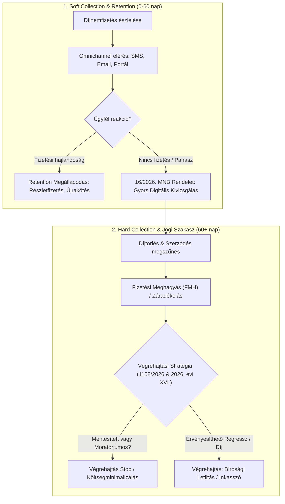

# Uniqa Collection & Retention Lead – Jogszabályfigyelő és Döntéstámogató Rendszer (2026)

[](file:///CHANGELOG.md)
[]()
[]()

> Célzott, automatizált jogszabály-monitorozó, adatkinyerő és stratégiai döntéstámogató keretrendszer a **Magyar Közlöny**, az **Indokolások Tára**, valamint a kibővített **4 jogforrás-pillér** (**MNB ajánlások 2020+**, **BHGY bírói gyakorlat –2025**, **Kúriai határozatok –2025**, **SZTFH rendeletek 2025+**) elemzésére, kifejezetten az **Uniqa – Collection & Retention Lead** pozíció vezetői interjújára és működési modelljére optimalizálva.

---

## 1. Főbb Képességek és Funkciók

- **Személyre Szabott Vezetői Interjú Felkészítő Playbook (v2.1):** [docs/FELKESZITO_ANYAG_UNIQA_COLLECTION_RETENTION_LEAD.md](file:///docs/FELKESZITO_ANYAG_UNIQA_COLLECTION_RETENTION_LEAD.md) – 30 mp Executive Pitch, a Finance & Accounting csapatbeli szerepkör dekódolása, 10 éles STAR modellválasz, intelligens visszakérdezési stratégia (Reverse Interviewing) és 1 oldalas puskázó kártya.
- **Interjú Szereplők és Döntéshozók Szakmai Dossziéja:** [docs/INTERJU_SZEREPLOK_DOSSSZIER.md](file:///docs/INTERJU_SZEREPLOK_DOSSSZIER.md) – Mészáros Petra (HR Generalist, ex-Grafton F&A) és Kiss Mariann / Pavel Kopylov (Számviteli és Pénzügyi Igazgatóság) szakmai háttere, motivációi és döntési szempontjai.
- **Multidiszciplináris 5P Mester Prompt Rendszer (v2.0):** Vezetői és prompt engineering módszertan az MNB ajánlások, bírósági jogesetek (BHGY, Kúria) és SZTFH hatósági normák szisztematikus kinyerésére és behajtási/megtartási konvertálására.
- **Részletes Adatforrás- és Rendszerspecifikáció:** [docs/SPECIFIKACIO_ES_ADATFORRASOK_V2.md](file:///docs/SPECIFIKACIO_ES_ADATFORRASOK_V2.md) a 4 pillér adatmodelljével (JSON schema), keresőszótárával és compliance garanciáival.
- **Tételes Jogszabályi Lajstrom & Hatáselemzés:**
  - **Bírósági Végrehajtás Átalakítása:** 1158/2026. (V. 18.) Korm. határozat elemzése a nonprofit bírósági modellre való áttérésről.
  - **Fogyasztói Moratórium:** 2026. évi XVI. törvény szerinti végrehajtási stop és perfüggesztés.
  - **Vht. 92. § Mentesítések:** Iskolakezdési támogatás és otthontámogatás végrehajtási védelme (2026. évi XXXIII. és XIV. törvény).
  - **MNB Panaszkezelési Keretrendszer:** 16/2026. (VI. 3.) MNB rendelet és kapcsolódó felügyeleti ajánlások (13/2022. etikus követeléskezelés).
  - **NVVH és Biztosítási Titok:** 2026. évi XXXIV. törvény adatszolgáltatási hatáskörei.
  - **SZTFH Végrehajtói Felügyelet:** Elektronikus Árverési Rendszer (EÁR) és végrehajtói díjrendeletek (10/2026. SZTFH rendelet).
- **Vezetői Interjú-Stratégia & Cheat Sheet:**
  - Soft & Hard Collection folyamatábrák (Mermaid).
  - Retention és Collection szinergiák (díjnemfizetés megelőzése, technikai vs. valós nemfizetés szétválasztása).
  - Vezetői interjúkérdések, modell-válaszok és felügyeleti érvelési panelek.
- **Automatizált Feed Letöltő & Dokumentumgeneráló:** PowerShell alapú közlöny-szűrő és COM-alapú Word (.docx) riportgenerátor.

---

## 2. Rendszerarchitektúra & Könyvtárstruktúra

```
uniqa-collection-retention-lead-prep/
│
├── .gitignore                         # Szigorú adatbiztonsági szűrő (Zero Data Leak: CV-k, profil PDF-ek tiltása)
├── README.md                          # Projekt Landing Page és rendszerleírás (v2.1.1)
├── CHANGELOG.md                       # Verziótörténet (SemVer 2.1.1)
├── run.bat                            # Gyökérszintű 9-pontos interaktív launcher (v2.1.1)
│
├── docs/
│   ├── FELKESZITO_ANYAG_UNIQA_COLLECTION_RETENTION_LEAD.docx # Formázott Word interjú playbook és 10 STAR modellválasz
│   ├── FELKESZITO_ANYAG_UNIQA_COLLECTION_RETENTION_LEAD.md   # Markdown forrásdokumentum
│   ├── UNIQA_CEGBEMUTATO_ES_ERTEKEK_2026.docx # Formázott Word cégbemutató, értékek, küldetés és vezetői iránytű
│   ├── UNIQA_CEGBEMUTATO_ES_ERTEKEK_2026.md   # Markdown cégbemutató és értékrend elemzés
│   ├── INTERJU_SZEREPLOK_DOSSSZIER.docx   # Formázott Word döntéshozói dosszié (HR és Szakmai vezetés)
│   ├── INTERJU_SZEREPLOK_DOSSSZIER.md     # Markdown döntéshozói elemzés
│   ├── INTEGRALT_JOGFORRAS_PLAYBOOK_2026.docx # Formázott Word vezetői playbook és KPI mátrix
│   ├── INTEGRALT_JOGFORRAS_PLAYBOOK_2026.md   # Markdown stratégiai playbook
│   ├── VEGREHAJTASI_ES_BIZTOSITASI_JOGANYAG_2026_UNIQA.docx # Formázott Word közlöny jogszabály-elemzés
│   ├── VEGREHAJTASI_ES_BIZTOSITASI_JOGANYAG_2026_UNIQA.md   # Markdown közlöny jogszabály-elemzés
│   ├── Uniqa_Collection_Retention_Lead_Joganyag_2026.docx    # 5 fejezetes formázott Word szakmai riport
│   ├── SPECIFIKACIO_ES_ADATFORRASOK_V2.md # 4 pilléres rendszer- és adatforrás specifikáció
│   ├── MESTER_PROMPT_V2_MULTI_SOURCE.md   # Bővített 5P Mester Prompt (MNB, BHGY, Kúria, SZTFH)
│   └── uniqa_allas_hirdetes.pdf           # Hivatalos Uniqa álláshirdetés (Finance & Accounting)
│
├── scripts/
│   ├── convert_all_md_to_docx.ps1     # Kötegelt Word COM (.docx) generátor minden dokumentumhoz
│   ├── convert_md_to_docx.ps1         # Egyedi Markdown -> Formázott Word (.docx) konverter
│   ├── generate_docx.ps1              # Word (.docx) automatikus 5 táblázatos generáló szkript (Word COM)
│   ├── run_all_scrapers.ps1           # Fő adatbegyűjtő és aggregáló modul (271 jogforrás elem)
│   ├── scrape_mnb.ps1                 # MNB felügyeleti ajánlások szűrője (2020-2026)
│   ├── scrape_sztfh.ps1               # SZTFH végrehajtási és árverési rendeletek szűrője (2025-2026+)
│   ├── scrape_kuria.ps1               # Kúriai határozatok és jogegységi döntések keresője (-2025)
│   ├── scrape_bhgy.ps1                # BHGY anonimizált bírósági precedensek feldolgozója (-2025)
│   └── fetch_feed.ps1                 # Valós idejű Magyar Közlöny RSS feldolgozó szkript
│
└── data/
    ├── aggregated_legal_data.json     # Teljes aggregált adatbázis (271 tétel statisztikával)
    ├── mnb_recommendations.json       # 143 MNB ajánlás (37 kiemelten releváns)
    ├── sztfh_decrees.json             # 80 SZTFH rendelet (20 végrehajtási relevanciájú)
    ├── kuria_decisions.json           # 42 Kúriai jogegységi határozat és precedens
    ├── bhgy_cases.json                # Anonimizált törvényszéki és ítélőtáblai jogesetek
    ├── bhgy_precedents.json           # Kurált kanonikus bírósági precedensbázis
    └── docx_content.json              # Word riport UTF-8 szöveg- és táblázatforrása
```

---

## 3. Gyorsindítás (Quick Start)

### Windows 1-Click Indítás:
Futtasd a projekt gyökerében lévő launchert:
```cmd
run.bat
```
A konzolos menüben választható az RSS feed frissítése, a scraperek indítása, vagy a szakmai döntéstámogató és interjú felkészítő dokumentáció közvetlen megnyitása:
```
[1] Magyar Kozlony RSS feed frissitese es szurese (PowerShell)
[2] 4 Pilleres Multi-Scraper futtatasa (MNB, SZTFH, Kuria, BHGY aggregacio)
[3] Vezetoi Interju Felkeszito megnyitasa Wordben (.docx)
[4] Interju Szereplok Dosszieja megnyitasa Wordben (.docx)
[5] Integralt Jogforras Playbook v2.0 megnyitasa Wordben (.docx)
[6] Birosagi es Biztositasi Joganyag 2026 megnyitasa Wordben (.docx)
[7] UNIQA Cegbemutato, Ertekek & Kuldetes megnyitasa Wordben (.docx)
[8] Word (.docx) dokumentumok teljes ujragenerlasa (Word COM)
[9] Kilepes
```

---

## 4. Vezetői Folyamatábra (Soft & Hard Collection)



---

## 5. Legfrissebb Kiadás (Release Highlights v2.1.0)

* **Személyre szabott Vezetői Interjú Felkészítő Playbook:** 10 konkrét, éles STAR modellválasz, 30 másodperces Executive Pitch, visszakérdezési terv és 1-oldalas puskázó kártya.
* **Döntéshozói Dosszié:** Mészáros Petra (HR) és Kiss Mariann / Pavel Kopylov (Finance & Accounting vezetés) mély szakmai és pszichológiai profilja.
* **8-pontos kibővített Launcher (`run.bat`):** Egy kattintással megnyitható minden felkészítő dokumentum.

---

## 6. Adatbiztonsági Szabályzat (Zero Data Leak v2.1)

A `.gitignore` szigorúan kizárja a személyes dokumentumokat (önéletrajzok, CV-k, külső profilkivonatok, jelszavak, tokenek). A Git tárolóba kizárólag a forráskódok, a generáló scriptek és az anonimizált szakmai elemzések kerülnek feltöltésre.

---

## 7. Közreműködők / Contributors

- **Teleki Norbert** – Projektgazda, folyamat- és követeléskezelési vezető, jogász
- **Google Antigravity AI** – Rendszertervező, scraper architektúra és dokumentációs partner

---

## 8. Licenc

Belső / Vállalati Döntéstámogató Rendszer © 2026 Teleki Norbert. Minden jog fenntartva.
