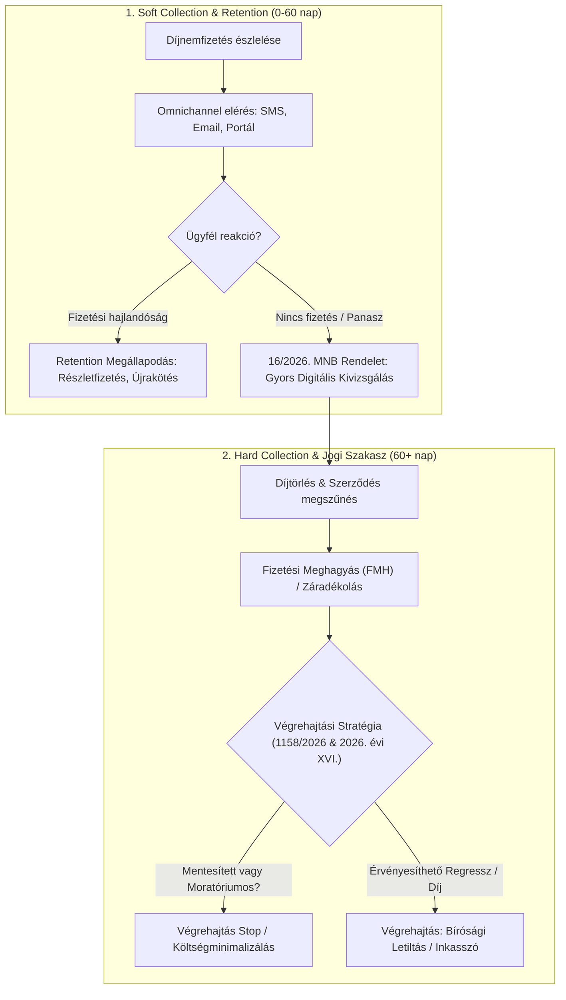

# Uniqa Collection & Retention Lead – Jogszabályfigyelő és Döntéstámogató Rendszer (2026)

[](file:///CHANGELOG.md)
[]()
[]()

> Célzott, automatizált jogszabály-monitorozó, adatkinyerő és stratégiai döntéstámogató keretrendszer a **Magyar Közlöny**, az **Indokolások Tára**, valamint a kibővített **4 jogforrás-pillér** (**MNB ajánlások 2020+**, **BHGY bírói gyakorlat –2025**, **Kúriai határozatok –2025**, **SZTFH rendeletek 2025+**) elemzésére, kifejezetten az **Uniqa – Collection & Retention Lead** pozíció vezetői interjújára és működési modelljére optimalizálva.

---

## 1. Főbb Képességek és Funkciók

- **Multidiszciplináris 5P Mester Prompt Rendszer (v2.0):** Vezetői és prompt engineering módszertan az MNB ajánlások, bírósági jogesetek (BHGY, Kúria) és SZTFH hatósági normák szisztematikus kinyerésére és behajtási/megtartási konvertálására.
- **Részletes Adatforrás- és Rendszerspecifikáció:** [docs/SPECIFIKACIO_ES_ADATFORRASOK_V2.md](file:///docs/SPECIFIKACIO_ES_ADATFORRASOK_V2.md) a 4 pillér adatmodelljével (JSON schema), keresőszótárával és compliance garanciáival.
- **Tételes Jogszabályi Lajstrom & Hatáselemzés:**
  - **Bírósági Végrehajtás Átalakítása:** 1158/2026. (V. 18.) Korm. határozat elemzése a nonprofit bírósági modellre való áttérésről.
  - **Fogyasztói Moratórium:** 2026. évi XVI. törvény szerinti végrehajtási stop és perfüggesztés.
  - **Vht. 92. § Mentesítések:** Iskolakezdési támogatás és otthontámogatás végrehajtási védelme (2026. évi XXXIII. és XIV. törvény).
  - **MNB Panaszkezelési Keretrendszer:** 16/2026. (VI. 3.) MNB rendelet és kapcsolódó felügyeleti ajánlások (13/2022. etikus követeléskezelés).
  - **NVVH és Biztosítási Titok:** 2026. évi XXXIV. törvény adatszolgáltatási hatáskörei.
  - **SZTFH Végrehajtói Felügyelet:** Elektronikus Árverési Rendszer (EÁR) és végrehajtói díjrendeletek (10/2026. SZTFH rendelet).
- **Vezetői Interjú-Stratégia & Cheat Sheet:**
  - Soft & Hard Collection folyamatábrák (Mermaid).
  - Retention és Collection szinergiák (díjnemfizetés megelőzése, regressz behajtás).
  - Vezetői interjúkérdések, modell-válaszok és felügyeleti érvelési panelek.
- **Automatizált Feed Letöltő & Dokumentumgeneráló:** PowerShell alapú közlöny-szűrő és COM-alapú Word (.docx) riportgenerátor.

---

## 2. Rendszerarchitektúra & Könyvtárstruktúra

```
uniqa-collection-retention-lead-prep/
│
├── .gitignore                         # Szigorú adatbiztonsági szűrő (Zero Data Leak: CV-k, PDF-ek tiltása)
├── README.md                          # Projekt Landing Page és rendszerleírás
├── CHANGELOG.md                       # Verziótörténet (SemVer 2.0.0)
├── run.bat                            # Gyökérszintű egykattintásos indító launcher (v2.0.0)
│
├── docs/
│   ├── SPECIFIKACIO_ES_ADATFORRASOK_V2.md # 4 pilléres rendszer- és adatforrás specifikáció
│   ├── MESTER_PROMPT_V2_MULTI_SOURCE.md   # Bővített 5P Mester Prompt (MNB, BHGY, Kúria, SZTFH)
│   ├── INTEGRALT_JOGFORRAS_PLAYBOOK_2026.md # Multidiszciplináris vezetői elemzés és interjú playbook
│   ├── VEGREHAJTASI_ES_BIZTOSITASI_JOGANYAG_2026_UNIQA.md # Közlöny-szintű 2026-os jogszabályi elemzés
│   └── Uniqa_Collection_Retention_Lead_Joganyag_2026.docx # 5 fejezetes formázott Word riport táblázatokkal
│
├── scripts/
│   ├── run_all_scrapers.ps1           # Fő adatbegyűjtő és aggregáló modul (271 jogforrás elem)
│   ├── scrape_mnb.ps1                 # MNB felügyeleti ajánlások szűrője (2020-2026)
│   ├── scrape_sztfh.ps1               # SZTFH végrehajtási és árverési rendeletek szűrője (2025-2026+)
│   ├── scrape_kuria.ps1               # Kúriai határozatok és jogegységi döntések keresője (-2025)
│   ├── scrape_bhgy.ps1                # BHGY anonimizált bírósági precedensek feldolgozója (-2025)
│   ├── fetch_feed.ps1                 # Valós idejű Magyar Közlöny RSS feldolgozó szkript
│   └── generate_docx.ps1              # Word (.docx) automatikus 5 táblázatos generáló szkript (Word COM)
│
└── data/
    ├── aggregated_legal_data.json     # Teljes aggregált adatbázis (271 tétel statisztikával)
    ├── mnb_recommendations.json       # 143 MNB ajánlás (37 kiemelten releváns)
    ├── sztfh_decrees.json             # 80 SZTFH rendelet (20 végrehajtási relevanciájú)
    ├── kuria_decisions.json           # 42 Kúriai jogegységi határozat és precedens
    ├── bhgy_cases.json                # Anonimizált törvényszéki és ítélőtáblai jogesetek
    ├── bhgy_precedents.json           # Kurált kanonikus bírósági precedensbázis
    └── docx_content.json              # Word riport UTF-8 szöveg- és táblázatforrása
```

---

## 3. Gyorsindítás (Quick Start)

### Windows 1-Click Indítás:
Futtasd a projekt gyökerében lévő launchert:
```cmd
run.bat
```
A konzolos menüben választható az RSS feed frissítése vagy a szakmai döntéstámogató dokumentáció megnyitása.

### Manuális PowerShell Futtatás:
```powershell
powershell -ExecutionPolicy Bypass -File .\scripts\fetch_feed.ps1 -StartDate "2026-04-12" -EndDate "2026-11-05"
```

---

## 4. Vezetői Folyamatábra (Soft & Hard Collection)



---

## 5. Adatbiztonsági Szabályzat (Zero Data Leak)

A `.gitignore` szabályai garantálják, hogy a forráskód-tárba kizárólag a kód, a felkészítő dokumentáció és a nyilvános jogszabály-elemzések kerüljenek be. Minden személyes adat (pl. önéletrajzok, CV-k, PDF állományok, belső azonosítók) tiltva van a commitokból.

---

## 6. Szerző és Licenc

- **Készült:** 2026. november 5.
- **Célpozíció:** Uniqa – Collection & Retention Lead
- **Verzió:** 1.0.0
