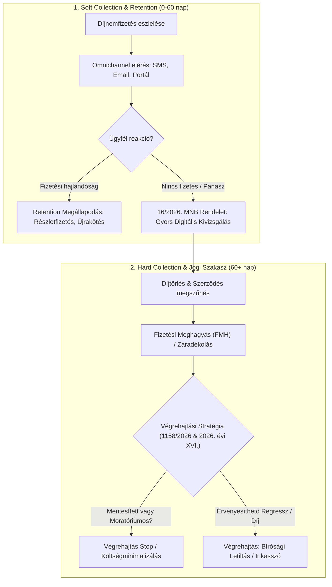

# Uniqa Collection & Retention Lead – Jogszabályfigyelő és Döntéstámogató Rendszer (2026)

[](file:///CHANGELOG.md)
[]()
[]()

> Célzott, automatizált jogszabály-monitorozó, adatkinyerő és stratégiai döntéstámogató keretrendszer a **Magyar Közlöny** és az **Indokolások Tára** 2026. évi (különösen a 2026.04.12 – 2026.11.05 közötti) bírósági végrehajtási és biztosítási szektorális jogváltozásainak elemzésére, kifejezetten az **Uniqa – Collection & Retention Lead** pozíció vezetői interjújára és működési modelljére optimalizálva.

---

## 1. Főbb Képességek és Funkciók

- **5P Mester Prompt Rendszer:** Vezetői és prompt engineering módszertan a bírósági végrehajtási (1994. évi LIII. tv. - Vht.) és biztosítási (Bit., Gfbt., MNB rendeletek) normák kinyerésére.
- **Tételes Jogszabályi Lajstrom & Hatáselemzés:**
  - **Bírósági Végrehajtás Átalakítása:** 1158/2026. (V. 18.) Korm. határozat elemzése a nonprofit bírósági modellre való áttérésről.
  - **Fogyasztói Moratórium:** 2026. évi XVI. törvény szerinti végrehajtási stop és perfüggesztés.
  - **Vht. 92. § Mentesítések:** Iskolakezdési támogatás végrehajtási védelme (2026. évi XXXIII. törvény).
  - **MNB Panaszkezelési Keretrendszer:** 16/2026. (VI. 3.) MNB rendelet digitális és határidő-szabályai.
  - **NVVH és Biztosítási Titok:** 2026. évi XXXIV. törvény adatszolgáltatási hatáskörei.
- **Vezetői Interjú-Stratégia & Cheat Sheet:**
  - Soft & Hard Collection folyamatábrák (Mermaid).
  - Retention és Collection szinergiák (díjnemfizetés megelőzése, regressz behajtás).
  - Vezetői interjúkérdések és modell-válaszok.
- **Automatizált Feed Letöltő:** PowerShell alapú, JSON-exportos valós idejű közlöny-szűrő modul.

---

## 2. Rendszerarchitektúra & Könyvtárstruktúra

```
uniqa-collection-retention-lead-prep/
│
├── .gitignore                         # Szigorú adatbiztonsági szűrő (Zero Data Leak: CV-k, PDF-ek tiltása)
├── README.md                          # Projekt Landing Page és rendszerleírás
├── CHANGELOG.md                       # Verziótörténet (SemVer 1.0.0)
├── run.bat                            # Gyökérszintű egykattintásos indító launcher (Windows)
│
├── docs/
│   ├── VEGREHAJTASI_ES_BIZTOSITASI_JOGANYAG_2026_UNIQA.md  # Teljes körű jogi és interjú-stratégiai anyag
│   └── Uniqa_Collection_Retention_Lead_Joganyag_2026.docx  # Strukturált Word dokumentum táblázattal
│
├── scripts/
│   ├── fetch_feed.ps1                 # Valós idejű Magyar Közlöny RSS feldolgozó és szűrő szkript
│   ├── generate_docx.ps1              # Word (.docx) automatikus generáló szkript (Word COM)
│   ├── parse_feed.ps1                 # RSS feed ellenőrző segédszkript
│   ├── parse_blocks.ps1               # Közlöny lapszám-blokk elemző szkript
│   └── inspect_item.ps1               # XML és mezőstruktúra-ellenőrző segédlet
│
└── data/
    ├── feed_sample.xml                # Minta Magyar Közlöny RSS feed állomány
    └── kozlony_feed.json              # Szűrt jogszabály-adatok kimenete (generálható)
```

---

## 3. Gyorsindítás (Quick Start)

### Windows 1-Click Indítás:
Futtasd a projekt gyökerében lévő launchert:
```cmd
run.bat
```
A konzolos menüben választható az RSS feed frissítése vagy a szakmai döntéstámogató dokumentáció megnyitása.

### Manuális PowerShell Futtatás:
```powershell
powershell -ExecutionPolicy Bypass -File .\scripts\fetch_feed.ps1 -StartDate "2026-04-12" -EndDate "2026-11-05"
```

---

## 4. Vezetői Folyamatábra (Soft & Hard Collection)



---

## 5. Adatbiztonsági Szabályzat (Zero Data Leak)

A `.gitignore` szabályai garantálják, hogy a forráskód-tárba kizárólag a kód, a felkészítő dokumentáció és a nyilvános jogszabály-elemzések kerüljenek be. Minden személyes adat (pl. önéletrajzok, CV-k, PDF állományok, belső azonosítók) tiltva van a commitokból.

---

## 6. Szerző és Licenc

- **Készült:** 2026. november 5.
- **Célpozíció:** Uniqa – Collection & Retention Lead
- **Verzió:** 1.0.0
