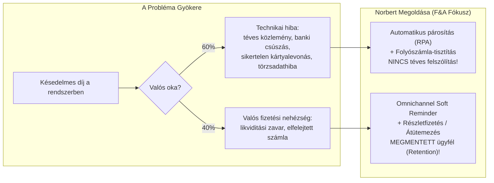
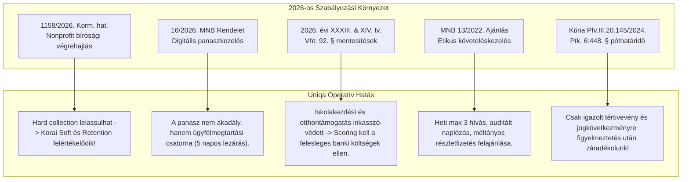

# UNIQA Collection & Retention Lead – Vezetői Felkészítő Anyag (2026)
## Személyre szabott Stratégiai Interjú Playbook és Modellválasz-Katalógus
**Jelölt:** Teleki Norbert  
**Interjúztatók:** Mészáros Petra (HR Generalist) & Szakmai Vezető (Finance & Accounting / Kiss Mariann)  
**Pozíció:** Collection & Retention Lead – INSURANCE  
**Dátum:** 2026. november 8.  
**Verzió:** 2.0 (Teljes multidiszciplináris integráció)

---

## TARTALOMJEGYZÉK
1. [Vezetői Profil és Stratégiai Értékajánlat (The Executive Pitch)](#1-vezetői-profil-és-stratégiai-értékajánlat)
2. [A Pozíció Dekódolása – Miért a Finance & Accounting a Kulcs?](#2-a-pozíció-dekódolása--miért-a-finance--accounting-a-kulcs)
3. [Interjúpartner-specifikus Megközelítés & Pszichológia](#3-interjúpartner-specifikus-megközelítés--pszichológia)
4. [A 2026-os Jogi és Felügyeleti Fegyvertár](#4-a-2026-os-jogi-és-felügyeleti-fegyvertár)
5. [Éles STAR Kérdés-Felelet Katalógus (10 Mesterválasz)](#5-éles-star-kérdés-felelet-katalógus)
6. [Intelligens Visszakérdezési Stratégia (Reverse Interviewing)](#6-intelligens-visszakérdezési-stratégia)
7. [1-Oldalas Interjú Napi Puskázó Kártya (Quick-Glance Cheat Sheet)](#7-1-oldalas-interjú-napi-puskázó-kártya)

---

## 1. VEZETŐI PROFIL ÉS STRATÉGIAI ÉRTÉKAJÁNLAT

### 1.1. A 30 Másodperces "Elevator Pitch"
> *"Teleki Norbert vagyok, több mint 10 éves tapasztalattal a pénzügyi és követeléskezelési szektorban, ahol az elmúlt 4 évben 50 fős operatív szervezetet vezettem az Intrumnál, havi 1,1–1,6 milliárd forintos cash-flow-ért, 700 000 jogi eljárásért és 400 000 ügyfél adatfolyamatáért felelve.*  
> *Erősségem a **folyamatoptimalizálás, az adatalapú döntéshozatal és az automatizáció**: 2025-ben elnyertem az Intrum Csoport Innovációs Díját, miután 18 RPA bot bevezetésével 20%-kal növeltük a feldolgozási kapacitást 10 FTE megtakarítása mellett, miközben Strategic Business Ownerként egy 6 milliárd forintos mérleg-egyeztetési projektet vittem sikerre.*  
> *Végzős jogászként (PPKE abszolutórium) és Lean Six Sigma minősítéssel a **'Compliance by Design'** elvét vallom: olyan digitális és automatizált díjbeszedési és emlékeztető rendszert hozok az Uniqa-hoz, amely azonnal kiszűri a technikai könyvelési hibákat, megmenti a fizetőképes ügyfeleket (Retention), és drasztikusan csökkenti a kintlévőségek tőkelekötését."*

### 1.2. A Négy Alappillér, Amivel Senki Nem Tud Versenyezni
| Terület | Norbert Teleki Bizonyított Eredményei | Uniqa Szükséglet & Relevancia |
| :--- | :--- | :--- |
| **Operatív & People Leadership** | 50+ fős szervezet közvetlen irányítása, műszak- és kapacitástervezés, alacsony fluktuáció, motivációs és bónuszrendszerek kidolgozása. | Stabil, tapasztalt vezető az Uniqa díjkezelési és reminder csapatának élére. |
| **Pénzügyi & Mérlegegyeztetés** | **6 milliárd Ft-os** financial balance reconciliation projekt üzleti vezetése; booking és függőszámlák felszámolása. | A díjkönyvelési hibák és technikai folyószámla-eltérések azonnali megszüntetése. |
| **Automatizáció & Skálázás** | **18 RPA bot**, évi 1,5M üzenetkezelés, 20% kapacitásnövekedés, 10 FTE megtakarítás (**Innovációs Díj 2025**). | Kintlévőség-monitorozó daemonok, automatizált reminder workflow-k. |
| **Jogi & Szabályozási Kiválóság** | **PPKE Jogász MA abszolutórium**, ISO 9001:2015 belső auditor, MNB 13/2022. és 16/2026. rendeleti ismeret. | 100%-os audit- és felügyeleti megfelelőség, pervesztési és záradéktörlési kockázatok nullázása. |

---

## 2. A POZÍCIÓ DEKÓDOLÁSA – MIÉRT A FINANCE & ACCOUNTING A KULCS?

Az álláshirdetés kifejezetten rögzíti: *"Join the Finance and Accounting team of an international insurance company, where you play a key role in making our premium payment processes even more efficient and take ownership of collection of insurance premiums and reminder management area."*

### A Vezetői Fókusz Eltolódása a Hagyományos Behajtástól:
A legtöbb jelölt elköveti azt a hibát, hogy ezt a pozíciót klasszikus "behajtási" (agresszív telefonos / ügyvédi) munkakörként értelmezi. **Az Uniqa-nál ez egy pénzügyi-műveleti folyamatirányítási pozíció:**



### Az 5 Fő Felelősségi Kör (Responsibilities) Válaszstratégiája:
1. **Manage and continuously monitor outstanding premiums:**
   * *Megoldás:* Valós idejű Power BI dashboardok létrehozása az aging bucketekre (D+0–15, D+16–30, D+31–60, D+60+ nap), termékcsoportonként (Gépjármű, Vagyon, Élet) szegmentálva.
2. **Identify the end-to-end process & focus on faulty processes:**
   * *Megoldás:* Lean Six Sigma / BPMN folyamattérképezés a kötvény kiállításától a banki jóváíráson át a jogi átadásig. Bottleneck-ek és manuális időveszteségek felszámolása.
3. **Improve collection efficiency & KPIs:**
   * *Megoldás:* DSO (Days Sales Outstanding) leszorítása, PTP (Promise to Pay) arány emelése 65% fölé, díjnemfizetés miatti törlés (Lapse Rate) 4,2% alatt tartása.
4. **Identify technical errors vs. genuine non-payment:**
   * *Megoldás:* A 6 milliárdos Intrum balance reconciliation metodikájának alkalmazása: booking szabályok finomhangolása, banki MT940/CAMT kivonatok intelligens feldolgozása.
5. **Regular management reporting:**
   * *Megoldás:* C-szintű döntéstámogatás Pavel Kopylov (CFO) és Kiss Mariann (Head of Accounting) számára a Solvency II kintlévőségi tőkekövetelmény minimalizálására.

---

## 3. INTERJÚPARTNER-SPECIFIKUS MEGKÖZELÍTÉS & PSZICHOLÓGIA

### 3.1. Mészáros Petra – HR Generalist
* **Ki ő?** Közel 6 évig toborzott a Grafton Recruitmentnél, kifejezetten **Finance & Accounting** profilra szakosodva. Corvinus MA (Vezetés és Szervezés) és NKE Adóigazgatási diplomája van. HPTI minősített szakértő.
* **Hogyan gondolkodik?**
  * Pontosan tudja, milyen egy jó pénzügyi vezető: nem dől be a felületes mellébeszélésnek, ismeri a számviteli kifejezéseket.
  * Azt figyeli, hogy egy erős, határozott egyéniség (50 fős csapat múlt) hogyan képes együttműködni egy mátrix szervezetben más területekkel (IT, Értékesítés, Ügyfélszolgálat).
  * Kiemelten fontos számára a **lojalitás, motiváció és az Uniqa iránti elkötelezettség**.
* **Hogyan nyerd meg őt?**
  * Említsd meg büszkén a márciusi pozitív tapasztalataidat Szőke Péterrel és a céggel kapcsolatos benyomásaidat: *„Már tavasszal lenyűgözött az Uniqa innovatív szemlélete és emberközpontú kultúrája. Amikor megláttam ezt a pozíciót a Pénzügy és Számvitel területen, azonnal tudtam: ez az a hely, ahol a 10 év operatív követeléskezelési, folyamatfejlesztési és jogi tapasztalatom 100%-ban találkozik a szervezet valós igényeivel.”*
  * Hangsúlyozd a stabil, támogató, coaching-szemléletű vezetési stílust.

### 3.2. Szakmai Vezető – Kiss Mariann (Head of Accounting) / F&A Osztályvezető
* **Ki ő?** Az Uniqa számviteli rendért felelős legfelsőbb szakmai vezetője, MABISZ bizottsági tag. Szigorú pénzügyi kontroll, audit- és jogszabályi megfelelés jellemzi.
* **Hogyan gondolkodik?**
  * Neki a kintlévőség nem jogi aktát jelent, hanem mérlegtételt, értékvesztést (impairment), tőkelekötést és ügyfélvesztést.
  * Legnagyobb félelme a hibás folyamatok miatt kialakuló könyvelési káosz, a függő tételek felhalmozódása és a felügyeleti (MNB) panaszok.
* **Hogyan nyerd meg őt?**
  * Beszélj a **folyamatok standardizálásáról (ISO 9001)**, az **egyenleg-egyeztetésről (reconciliation)** és a **technikai számlák likvidálásáról**.
  * Bizonyítsd be, hogy nem pereskedni akarsz, hanem a korai szakaszban megvédeni a társaság cash-flow-ját és a díjbevételt.

---

## 4. A 2026-OS JOGI ÉS FELÜGYELETI FEGYVERTÁR

A beszélgetés során emeld be a legfrissebb, 2026-os jogalkotási és felügyeleti változásokat, bizonyítva kivételes felkészültségedet:



---

## 5. ÉLES STAR KÉRDÉS-FELELET KATALÓGUS

### 1. KÉRDÉS (HR / Motiváció):
*"Több mint 10 évet töltöttél az Intrumnál, legutóbb 50 fős behajtási csapatot vezettél. Miért jöttél el, és miért pont az Uniqa Pénzügy-Számvitel csapata vonz?"*
* **Szituáció:** Az Intrumnál stratégiai átszervezés zajlott le, a cég a dinamikus innováció és növekedés helyett a szinten tartásra és a költségvágásra helyezte a hangsúlyt.
* **Feladat:** Olyan szervezetet keresni, ahol az innováció, a technológiai fejlődés és a minőségi ügyfélkapcsolat valódi stratégiai érték.
* **Cselekvés:** *„Nem kényszerből léptem le, hanem tudatos döntést hoztam. Számomra az innováció nem divatszó: Innovációs Díjat nyertem 18 RPA bot bevezetésével, és a záróvizsgáim előtt álló jogászként olyan környezetet kerestem, ahol a szabályozottság és a modern digitális eszközök kéz a kézben járnak. Márciusban volt szerencsém alaposan megismerni az Uniqa kultúráját, és azonnal nyilvánvalóvá vált, hogy a cég nyitott a modern megoldásokra. Ebben a pozícióban nem pusztán behajtásról van szó: a Pénzügy és Számvitel alatt működve a teljes díjbeszedési és emlékeztető folyamatot kell hatékonyabbá tenni, ami pontosan a szakterületem.”*
* **Eredmény:** Teljesen transzparens, pozitív kicsengésű váltási narratíva, amely megerősíti az elkötelezettséget.

---

### 2. KÉRDÉS (Szakmai / Folyamathiba vs. Nemfizetés):
*"Az álláshirdetésben kulcselemként említjük: 'Identify the causes of outstanding receivables (technical errors vs genuine non-payment)'. Hogyan oldanád ezt meg a gyakorlatban?"*
* **Szituáció:** Sok esetben a kintlévőség nem valós ügyfél-nemfizetésből fakad, hanem rendszerhibákból: banki tranzakciós csúszások, téves közlemények, sikertelen csoportos beszedési megbízások vagy rosszul felparaméterezett biztosítástechnikai számlák.
* **Feladat:** Megakadályozni, hogy jó ügyfelek kapjanak fenyegető felszólítást, miközben a valós nemfizetőket azonnal elérjük.
* **Cselekvés:** *„Az Intrumnál Strategic Business Ownerként egy 6 milliárd forintos pénzügyi mérleg- és egyenleg-egyeztetési projektet vezettem, így pontosan ismerem a 'booking' logikát. Első lépésként egy automatizált adategyeztető logikát vezetnék be:*
  * *1. Kivonatolási szűrés: A banki jóváírások (MT940/CAMT) és a díjkönyvelési analitika napi automatikus párosítása. Ha a név stimmel, de a kötvényszám elgépelt, egy 'fuzzy matching' algoritmus vagy RPA azonnal a megfelelő függőszámlára irányítja a tételt.*
  * *2. Csoportos beszedési (VIBER/SEPA) hibakód-elemzés: Pontosan el kell különíteni az 'átmeneti fedezethiányt' a 'megszüntetett bankszámlától'.*
  * *3. Technikai hibánál belső eszkaláció történik (IT / Díjkönyvelés), nem pedig külső ügyfélzaklatás. Csak akkor indítunk emlékeztetőt (Reminder), ha a díjtartozás mögött igazoltan valós fizetési mulasztás áll.”*
* **Eredmény:** Drasztikusan csökkenő ügyfélpanaszok, tiszta folyószámlák, megmentett ügyfélélmény.

---

### 3. KÉRDÉS (Retention & Collection Szinergia):
*"Hogyan egyeztethető össze a kintlévőség behajtása (Collection) az ügyfélmegtartással (Retention) egy biztosítónál?"*
* **Szituáció:** A biztosításban a díjnemfizetés miatti törlés (Lapse) végleges ügyfélvesztést és jövőbeli díjbevétel-kiesést jelent. A peres behajtás költsége gyakran meghaladja a díj összegét.
* **Feladat:** A korai (D+1–45 napos) szakaszban maximalizálni a megtartást, miközben a cash-flow beérkezik.
* **Cselekvés:** *„Az MNB 13/2022. számú etikus követeléskezelési ajánlása és a 16/2026. panaszkezelési rendelet pontosan egybecseng az üzleti érdekkel: a késedelmes ügyfél nem ellenség, hanem a Retention első számú célpontja. A korai szakaszban nem fenyegető leveleket küldünk, hanem barátságos, többcsatornás (SMS, e-mail, Uniqa portál push) értesítőket egykattintásos bankkártyás fizetési linkkel. Ha az ügyfél likviditási nehézséggel küzd, azonnal felajánljuk a részletfizetést vagy a fedezet átstrukturálását, megelőzve a kötvény megszűnését. A peresítésbe kizárólag a jogilag tiszta, vagyoni fedezettel rendelkező regresszeket és lezárt szerződéseket engedjük tovább.”*
* **Eredmény:** 4% alatti lapse rate, magasabb ügyfélmegtartási arány és azonnali cash-flow.

---

### 4. KÉRDÉS (Szakmai / KPI & Adatalapú Vezetés):
*"Milyen konkrét KPI-okat vezetnél be és hogyan prezentálnád ezeket a felsővezetésnek (CFO, Számvitel)?"*
* **Szituáció:** A kintlévőség-kezelést gyakran csak a havi lezárás után, statikus Excel táblákból látják, ami késlelteti a beavatkozást.
* **Feladat:** Valós idejű, transzparens vezetői döntéstámogatás kialakítása.
* **Cselekvés:** *„Power BI alapon 4 szintű KPI mátrixot építek ki:*
  * *1. Likviditási és hatékonysági mutatók: DSO (napokban), Total Overdue Receivables és korosítás (0-30, 31-60, 61-90, 90+ nap).*
  * *2. Folyamathatékonyság: STP arány (Straight Through Processing a díjkönyvelésben), függőtételes számlák aránya (<1%).*
  * *3. Megtérülési mutatók: Early Soft PTP (Promise to Pay) arány (>65%), Felszólítási sikerességi ráta csatornánként (SMS vs. e-mail vs. postai levél).*
  * *4. Compliance & Retention: Díjtörlési arány (Lapse Rate <4.2%), panaszos ügyek átfutási ideje (cél: 5 nap az MNB 30 napos korlátjával szemben).*
  * *A vezetés felé MBR/QBR keretében nem nyers adatokat viszek, hanem vezetői hatásvizsgálatot: mennyi tőkét szabadítottunk fel, és hol van folyamati elakadás.”*
* **Eredmény:** Stratégiai szintű kontroll és transzparencia Pavel Kopylov és Kiss Mariann számára.

---

### 5. KÉRDÉS (People Management & HR):
*"50 fős csapatot vezettél. Hogyan motiválod a munkatársakat a monoton, adminisztratív vagy leterhelt időszakokban?"*
* **Szituáció:** A díjkezelési és emlékeztetői adminisztráció havi zárások idején rendkívül monoton és stresszes lehet.
* **Feladat:** A kiégés megelőzése, a fluktuáció leszorítása és a pontosság fenntartása.
* **Cselekvés:** *„Három alapelvet alkalmazok:*
  * *1. Értelmet adni a munkának: A kollégáknak látniuk kell, hogy a munkájuk nem adminisztratív favágás, hanem a biztosító működésének alapköve. Ha ők jól dolgoznak, az ügyfél nem veszíti el a biztosítási védelmét.*
  * *2. Automatizációval tehermentesíteni: Az Intrumnál a 18 RPA botot nem a kollégák ellen, hanem értük vezettük be – levettük a vállukról a tömeges gépelést és kivonatpárosítást, így a hibák felderítésére koncentrálhattak.*
  * *3. Transzparens visszajelzés és coaching: Napi standupok, egyéni 1-on-1 meetingek, és az elért sikerek azonnali elismerése. Nemcsak a hibát keressük, hanem a javulást jutalmazzuk.”*
* **Eredmény:** Magas munkatársi elégedettség, minimális elvándorlás és kiváló folyamatfegyelem.

---

### 6. KÉRDÉS (Keresztfunkcionális Együttműködés):
*"Mihez kezdesz, ha az Értékesítés (Sales) felháborodva hív fel, hogy a díjbeszedési felszólítások miatt lemondják az ügyfelek a szerződéseket?"*
* **Szituáció:** Örök ellentét az értékesítés (akik az új kötvényeket hozzák) és a pénzügy/collection (akik a pénzt várják) között.
* **Feladat:** Konstruktív szinergia megteremtése a konfliktus helyett.
* **Cselekvés:** *„Nem védekező pozíciót veszek fel, hanem odaülök a Sales vezetővel egy asztalhoz adatokkal:*
  * *Megmutatom a szegmentációt: valóban fizetőképes ügyfélről van-e szó, vagy krónikus nemfizetőről?*
  * *Ha technikai vagy adminisztrációs oka volt a felszólításnak, azonnal elnézést kérünk és leállítjuk a folyamatot.*
  * *Bevezetem a 'Pre-reminder Sales Alert' mechanizmust: a VIP vagy flottás ügyfelek 30 napos késedelménél a rendszer először a közvetítőt/üzletkötőt értesíti, hogy személyesen segíthessen tisztázni a helyzetet, még mielőtt hivatalos jogi felszólító menne ki.*
  * *Így a Sales nem ellenfélként, hanem támogató partnerként tekint a pénzügyi folyamatra.”*
* **Eredmény:** Közös cél, az értékesítési hálózat bizalmának elnyerése.

---

### 7. KÉRDÉS (Jogi & Peresítési Kockázat):
*"Hogyan hat a 1158/2026. Korm. határozat (a végrehajtás bírósági szervezetbe vonása) az Uniqa kintlévőség-kezelési stratégiájára?"*
* **Szituáció:** A kormányrendelet elindította a bírósági végrehajtói rendszer felülvizsgálatát, célul kitűzve a profitorientációtól mentes, bírósági kereteken belüli működést.
* **Feladat:** Felkészíteni a biztosítót az átmeneti végrehajtói kapacitáscsökkenésre és a megnövekedett perköltség-kockázatokra.
* **Cselekvés:** *„Jogászként pontosan látom a trendet: a bírósági végrehajtási szakasz elhúzódóbbá válhat, ezért a 'Smart Enforcement' stratégiát kell követnünk:*
  * *1. A megtérülést a D+0–60 napos Soft fázisban kell megnyerni, mert a végrehajtási szakasz megtérülési sebessége (DSO) növekedni fog.*
  * *2. A bírósági szakasz előtt (FMH, záradékolás) szigorú vagyoni szűrést végzünk: kizárólag a valós munkabérrel, gépjárművel vagy ingatlannal rendelkező ügyfeleknél indítunk eljárást, megelőzve az eredménytelen eljárási illetékek felhalmozódását.*
  * *3. Szigorúan ügyelünk a Vht. 92. § új mentesítési szabályaira (a 2026. évi XXXIII. törvény szerinti iskolakezdési támogatás és a XIV. törvény szerinti otthontámogatás mentesítése), hogy elkerüljük a jogalap nélküli inkasszókat és bírósági perköltségeket.”*
* **Eredmény:** Minimális jogi költségveszteség, fókuszált végrehajtási hatékonyság.

---

### 8. KÉRDÉS (Automatizáció és AI):
*"Milyen automatizációs lehetőséget látnál a díjbeszedésben az első 6 hónapban?"*
* **Szituáció:** A manuális ellenőrzések és sablonlevelek készítése sok munkaórát köt le a pénzügyön.
* **Feladat:** Gyors, alacsony költségű, azonnali megtérülést (Quick Win) hozó automatizációk bevezetése.
* **Cselekvés:** *„A bevált háromlépcsős módszertanomat alkalmaznám:*
  * *1. Lépés: Lean folyamattisztítás – megszüntetni a felesleges jóváhagyási köröket.*
  * *2. Lépés: RPA botok a díjkönyvelési párosításra és a postai tértivevények státuszkövetésére. Ha az RPA detektálja az átvételt, a rendszer automatikusan lépteti a státuszt.*
  * *3. Lépés: Késedelmi kockázati scoring (AI/Machine Learning): az ügyfél korábbi fizetési fegyelme, a szerződés típusa és az összeg alapján prediktív modellt készítünk, amely meghatározza az optimális megkeresési csatornát és időpontot (SMS reggel, e-mail délután, hívás csak D+30 után).*
  * *Mindezt szigorúan az EU AI Act és a GDPR keretein belül, 'Compliance by Design' alapon.”*
* **Eredmény:** Akár 15-20%-os adminisztrációs kapacitás-felszabadulás és gyorsabb pénzbeáramlás.

---

### 9. KÉRDÉS (Trükkös / Szakmai Számvitel):
*"Mi a teendő, ha egy ügyfél túlfizetett egy megszűnt szerződésen, miközben egy másik aktív kötvényén díjhátraléka van?"*
* **Szituáció:** Pénzügyi és jogi dilemma: átvezethető-e automatikusan az összeg a szerződések között?
* **Feladat:** Számviteli pontosság és jogi megfelelőség biztosítása (Ptk. és biztosítási titok).
* **Cselekvés:** *„Ptk. 6:49. § szerinti beszámítás és folyószámla-rendezés:*
  * *1. Ha a szerződő azonos személy, a biztosítónak joga van beszámítással élni, de erről kötelező joghatályos értesítést küldeni az ügyfélnek, egyértelműen bemutatva mindkét alszámla egyenlegét.*
  * *2. Azonban az ügyfélélmény és retention szempontjából a legjobb gyakorlat a proaktív digitális értesítés: SMS-ben vagy ügyfélfiókban jelezzük a túlfizetést és felajánljuk az egykattintásos átvezetést a díjhátralékos szerződésre.*
  * *3. Így nem keletkezik panasz, nem könyvelünk tévesen, és a kintlévőség azonnal likvidálódik.”*
* **Eredmény:** Hiba nélküli könyvelés és elégedett ügyfél.

---

### 10. KÉRDÉS (HR / Nehéz Szituáció):
*"Mesélj egy olyan helyzetről, amikor hibáztál vagy egy projekted elakadt! Mit tanultál belőle?"*
* **Szituáció:** Egy korábbi ERP automatizációs bevezetés során az induláskor nem számoltunk a felhalmozódó értesítési backloggal.
* **Feladat:** A krízis kezelése és a folyamat helyreállítása.
* **Cselekvés:** *„A pályám elején történt, hogy egy automatizált értesítési folyamatnál meg voltam győződve a logikai helyességről, de nem vontam be kellő mélységben a végső felhasználókat és nem tisztítottuk meg eléggé a kiinduló törzsadatokat. Az eredmény: a rendszer hirtelen kezelhetetlen mennyiségű belső figyelmeztetést generált.*
  * *Azonnal felvállaltam a felelősséget, ideiglenesen leállítottam az automatizációt.*
  * *Leültem a csapattal, elvégeztük az alapos adattisztítást és újraparamétereztük a küszöbértékeket.*
  * *Mit tanultam ebből? Azt, hogy egyetlen automatizáció sem működhet tiszta alapadatok és a folyamatot kezelő emberek bevonása nélkül. Azóta minden technológiai projektemet kőkemény adattisztítással és kisléptékű sandbox-pilottal indítom.”*
* **Eredmény:** Őszinte, érett vezetői önreflexió, ami bizalmat épít a HR-esnél és a szakmai vezetőnél is.

---

## 6. INTELLIGENS VISSZAKÉRDEZÉSI STRATÉGIA (REVERSE INTERVIEWING)

Amikor az interjú végén megkérdezik: *"Van kérdése hozzánk?"*, az alábbi célzott kérdésekkel véglegesítheted a győzelmet:

### Kérdések Mészáros Petrának (HR):
1. *„Hogyan támogatja jelenleg az Uniqa a Finance & Accounting csapatban dolgozók szakmai fejlődését és a belső karrierutakat?”*
2. *„Milyen a csapat dinamikája és a jelenlegi hibrid munkavégzési modell aránya a mindennapokban ezen a területen?”*
3. *„Az Ön szemében mi különbözteti meg az igazán sikeres vezetőt az Uniqa kultúrájában az átlagostól?”*

### Kérdések a Szakmai Vezetőnek (Kiss Mariann / F&A Head):
1. *„A prémium beáramlás és a banki jóváírások (MT940/CAMT) párosítása mekkora arányban automatizált jelenleg a Core rendszerben, és mekkora manuális ráfordítást igényel a díjkönyveléstől?”*
2. *„Hogyan látja: a díjhátralékos állományban jelenleg a technikai/adatrögzítési hibák vagy a valós ügyfél-nemfizetések jelentik a nagyobb operatív kihívást?”*
3. *„Milyen elvárásaik vannak az új vezetővel szemben az első 90 napban: mi lenne az a konkrét eredmény vagy folyamati javulás, amire 3 hónap múlva azt mondanák, hogy kiváló döntés volt a kinevezése?”*

---

## 7. 1-OLDALAS INTERJÚ NAPI PUSKÁZÓ KÁRTYA

```
┌────────────────────────────────────────────────────────────────────────────────────────┐
│                      UNIQA COLLECTION & RETENTION LEAD CHEAT SHEET                     │
├────────────────────────────────────────────────────────────────────────────────────────┤
│ SZEMÉLYES SZÁMOK & SIKEREK:                                                            │
│ • 10+ év pénzügyi & követeléskezelési tapasztalat (Intrum, SAP Leasing)                │
│ • 50 fős operatív csapatvezetés | 1,1–1,6 Mrd Ft havi portfólió | 700 000 jogi ügy    │
│ • 6 Mrd Ft-os számlaegyeztetési projekt üzleti vezetése (Booking / Reconciliation)    │
│ • 18 RPA bot | 20% kapacitásnövekedés | 10 FTE megtakarítás -> INNOVÁCIÓS DÍJ 2025    │
│ • Végzős jogász (PPKE abszolutórium) | Lean Six Sigma Green Belt | ISO 9001 auditor   │
├────────────────────────────────────────────────────────────────────────────────────────┤
│ A POZÍCIÓ LEGFŐBB VEZÉRELVE:                                                           │
│ • "A pozíció a Pénzügy-Számvitel része: nem agresszív behajtó kell, hanem folyamat- és │
│   pénzügyi műveleti vezető, aki rendet tesz a folyószámlákon és megmenti az ügyfelet!"  │
│ • Technikai hiba (60%) != Valós nemfizetés (40%) -> Adattisztítás és RPA a megoldás!  │
├────────────────────────────────────────────────────────────────────────────────────────┤
│ 2026-OS SZABÁLYOZÁSI KULCSSZAVAK (BEDOBNI AZ INTERJÚN!):                                │
│ • 1158/2026 Korm. hat.: Nonprofit végrehajtási átállás -> Korai Soft és Retention kell!│
│ • 16/2026 MNB rendelet: Digitális panaszkezelés -> Panasz = Ügyfélmegtartási esély!   │
│ • 2026. évi XXXIII. tv. & Vht. 92. §: Iskolakezdési (100e Ft) és Otthontámogatás      │
│   teljesen mentes az inkasszó alól -> Scoring kell a felesleges banki költségek ellen!  │
│ • MNB 13/2022: Etikus adóskezelés (max 3 hívás/hét, auditált napló, méltányos részlet)│
│ • Kúria Pfv.III.20.145/2024: Ptk. 6:448. § szerinti igazolt tértivevény a peresítéshez │
├────────────────────────────────────────────────────────────────────────────────────────┤
│ DÖNTÉSHOZÓI HANGOLÁS:                                                                  │
│ • Mészáros Petra (HR): Grafton F&A toborzási múlt! Stabilitás, coaching vezetés,       │
│   Uniqa kultúra iránti elkötelezettség (márciusi pozitív benyomás felidézése).         │
│ • Kiss Mariann (Számvitel): Folyószámla-tisztaság, tőkelekötés-csökkentés, automatikus │
│   párosítás, auditálható kontrollok, vezetői Power BI reporting.                       │
└────────────────────────────────────────────────────────────────────────────────────────┘
```
