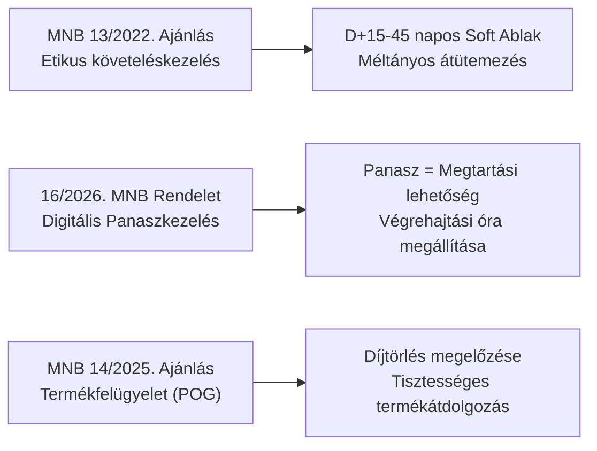
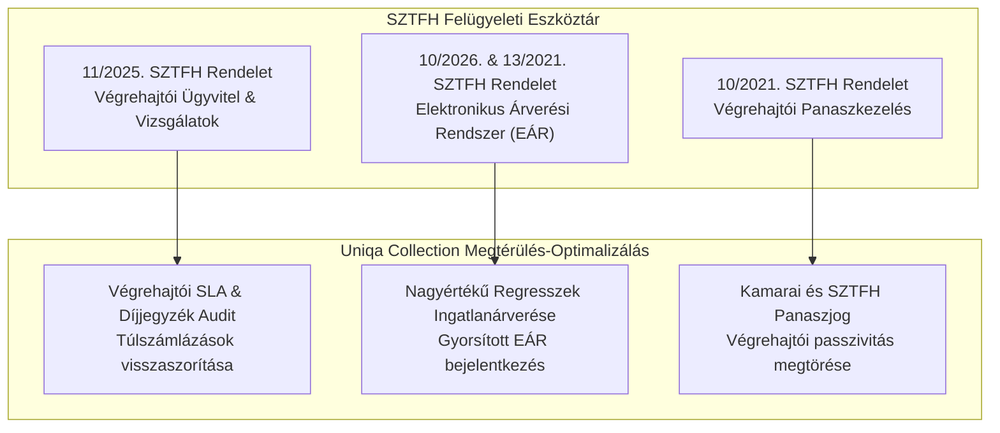
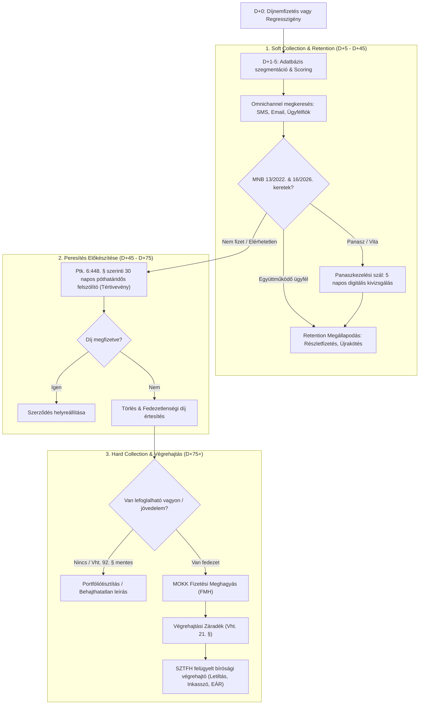

# Integrált Jogforrás & Vezetői Döntéstámogató Playbook (v2.0)
## Uniqa Collection & Retention Lead – Multidiszciplináris Stratégiai Elemzés

**Verzió:** 2.0.0  
**Készült:** 2026. november 6.  
**Alapul vett források:** Magyar Közlöny (2026), MNB Felügyeleti Ajánlások (2020–2026), SZTFH Rendeletek (2025–2026+), Kúriai Határozatok és JPE (-2025), BHGY Bírósági Precedensek (-2025).

---

## VEZETŐI ÖSSZEFOGLALÓ (EXECUTIVE SUMMARY)

A biztosítási piacon a díjbehajtás (*Collection*) és az ügyfélmegtartás (*Retention*) elválaszthatatlan stratégiai szimbiózisban működik. A 2026-os jogalkotási reformok (különösen a bírósági végrehajtás nonprofit államosításának előkészítése és az MNB szigorított panaszkezelési előírásai), valamint a Kúria és az ítélőtáblák bírósági gyakorlata egyértelmű üzenetet fogalmaznak meg a felsővezetés számára:

> **Vezetői Alaptétel:**  
> *A megtérülést és a portfólió profitabilitását a jogi peresítés előtt, a **Soft Collection (0–60 napos)** ablakban kell megnyerni. A késedelmes ügyfél nem szimpla behajtási alany, hanem a Retention első számú célcsoportja. A bírósági szakaszba (Hard Collection) kizárólag a jogilag golyóálló, vagyoni fedezettel rendelkező regressz- és nagyértékű díjtartozásokat szabad továbbengedni.*

---

## 1. PILLÉR: MNB AJÁNLÁSOK ÉS FELÜGYELETI MEGFELELÉS (2020–2026)

Az MNB felügyeleti eszköztára határozza meg a biztosítók etikus ügyfélkapcsolati és kockázatkezelési határait.

### Kiemelt MNB Normák Részletes Vizsgálata:

1. **13/2022. (VIII. 11.) MNB Ajánlás – Követeléskezelési és adósvédelmi elvárások:**
   - **Előírás:** A hitelező köteles megelőzni az ügyfelek túlzott pszichés terhelését (heti maximum 3 sikeres telefonos megkeresés). A késedelem okának feltárása után kötelező fizetéskönnyítési alternatívát (részletfizetés, tőkésítés, türelmi idő) ajánlani.
   - **Collection hatás:** A behajtási hívásrendszert (dialer) szigorú hívásszámlálóval és auditált logolással kell ellátni. A behajtást végző call center és külső partnerek KPI-jait a megegyezési arányhoz (Promise to Pay - PTP), nem pedig a fenyegető fellépéshez kell kötni.
   - **Retention hatás:** A likviditási nehézséggel küzdő ügyfél megtartása érdekében azonnal aktiválható az alacsonyabb fedezetű vagy átütemezett konstrukció.

2. **16/2026. (VI. 3.) MNB Rendelet & 7/2021. MNB Ajánlás – Panaszkezelési keretrendszer:**
   - **Előírás:** Minden olyan biztosító, amely honlapot működtet, köteles a panaszkezelési szabályzatot és nyomtatványt azonnal elérhetővé tenni. A szóbeli panaszokra adott érdemi választ az ügyfél kérésére kötelező digitálisan (ügyfélfiók, portál, hitelesített e-mail) megküldeni.
   - **Lead Stratégia:** Ha egy díjhátralékos ügyfél panasszal él, a behajtási folyamatot ideiglenesen felfüggesztjük, és a Retention specialistát vonjuk be. A panasz 5 napon belüli sikeres lezárása azonnali megtartási és fizetési hajlandóságot generál.

3. **14/2025. (XII. 9.) MNB Ajánlás – Termékfelügyelet és termékirányítás (POG):**
   - **Előírás:** A biztosítási termékek díjfizetési struktúrájának és megszűnési mechanizmusainak átláthatónak kell lenniük.
   - **Lead Stratégia:** A biztosítói díjértesítőknek és felszólító leveleknek egyértelműen tartalmazniuk kell a fedezetlenségi díj és a jogi következmények pontos kalkulációját.

---

## 2. PILLÉR: KÚRIAI PRECEDENSEK ÉS JOGEGYSÉGI HATÁROZATOK (-2025)

A legfelsőbb bírósági fórum döntései közvetlenül meghatározzák a biztosítási peresítés kockázatait és szabályait.

| Ügyszám / Határozat | Érintett Jogszabály | Kulcsfontosságú Jogtétel | Vezetői / Operatív Relevancia |
| :--- | :--- | :--- | :--- |
| **Pfv.III.20.145/2024/6.** | Ptk. 6:448. § | **Póthatáridős felszólítás alakisága:** A díjnemfizetés miatti felmondás kizárólag akkor hatályos, ha a 30 napos póthatáridőt tűző felhívás kifejezetten figyelmeztet a jogkövetkezményekre, és a kézbesítés igazolt. | A biztosító pervesztes lesz, ha a felszólító levél sablonszerű, vagy nincs meg a postai tértivevény / hiteles elektronikus kézbesítési igazolás. |
| **Gfv.VII.30.210/2023/8.** | Gfbt. 34. § | **Regresszkövetelés és ittas vezetés:** A biztosító mentesülése a károsult felé kifizetett összeg erejéig feltétlen, a károkozóval szembeni visszkövetelésnél a büntetőítéletben rögzített véralkohol-szint köti a polgári bíróságot. | A kárrendezési és jogi osztály integrációjával a büntetőbírósági jogerő napján automatikusan ki kell bocsátani az FMH-t, megelőzve az elévülést. |
| **Jpe.I.60.012/2024/5.** | Ptk. 6:102. § | **Tisztességtelen általános szerződési feltételek:** Fogyasztói szerződésekben az egyoldalú, előre nem látható késedelmi pótdíjak és adminisztrációs behajtási költségek semmisek. | A Soft Collection során kizárólag a jogszabályi késedelmi kamat és a ténylegesen felmerült, igazolt postaköltség hárítható át. |
| **Pfv.V.21.089/2025/4.** | Ptk. 6:468. § | **Biztosítási igények 1 éves elévülése:** A biztosítási szerződésből eredő díj- és regresszkövetelések 1 év alatt elévülnek. A végrehajtási szakaszban az elévülést csak az érdemi végrehajtási cselekmény szakítja meg. | Automatizált elévülési riasztó (trigger) beépítése a CRM/Core rendszerbe a D+270 napnál, ha a végrehajtó nem intézkedett. |

---

## 3. PILLÉR: BHGY BÍRÓSÁGI GYAKORLAT ÉS ANOMÁLIÁK (-2025)

Az első- és másodfokú bíróságok (Törvényszékek, Ítélőtáblák) határozatai rávilágítanak a végrehajtási eljárások mindennapi gyakorlati buktatóira:

### 1. Vht. 41. § és 56. § szerinti peres kockázatok (Záradéktörlés):
* **Bírói gyakorlat (pl. Fővárosi Törvényszék 26.P.22.451/2024/18.):** Ha az adós pert indít a végrehajtási záradék törlése iránt a díjhátralék vitatása miatt, a bíróságok szigorúan vizsgálják a kézbesítési fikció (Vht. 37/A. §) feltételeit. Ha a biztosító téves címre küldte a felszólítót, a záradékot törlik, a perköltséget és végrehajtási illetéket a biztosító fizeti.
* **Vezetői Intézkedés:** Tértivevény-ellenőrző algoritmus bevezetése: csak akkor záradékolunk, ha a "Nem kereste" vagy "Átvette" jelzés igazolható.

### 2. Vht. 79/A. § és 92. § Folyószámla-mentesítési jogviták:
* **Bírói gyakorlat (pl. Győri Ítélőtábla Pf.I.20.092/2024/9.):** A banki inkasszók során jogalap nélküli végrehajtásnak minősül a törvényben védett juttatások (családi pótlék, anyasági támogatás, valamint az új 2026. évi XXXIII. és XIV. törvény szerinti iskolakezdési és otthontámogatás) elvonása.
* **Vezetői Intézkedés:** Inkasszós scoring: a lakossági kisösszegű díjtartozásoknál nem indítunk azonnali bankszámla-letiltást addig, amíg nincs jövedelem- vagy munkahely-adat, megelőzve a felesleges banki költségeket és ügyfélsértést.

### 3. Gfbt. szerinti Fedezetlenségi Díj Megítélése:
* **Bírói gyakorlat (pl. Pécsi Törvényszék 11.G.40.115/2023/14.):** Az üzembentartó fizetési kötelezettsége feltétlen mindaddig, amíg a gépjármű forgalomból való kivonása a hatósági nyilvántartásban nem szerepel.
* **Vezetői Intézkedés:** Kárnyilvántartó (Gfbt.) automatikus integráció: a díjhátralék miatti szerződésbontás előtt azonnal figyelmeztetjük az ügyfelet a napi fedezetlenségi díj mértékére.

---

## 4. PILLÉR: SZTFH FELÜGYELETI RENDELETEK (2025–2026+)

A Szabályozott Tevékenységek Felügyeleti Hatósága felügyeli a Magyar Bírósági Végrehajtói Kar (MBVK) és a végrehajtók tevékenységét.

* **11/2025. (XI. 26.) SZTFH Rendelet:** Rögzíti az önálló bírósági végrehajtók ellenőrzésének és elszámolásának szabályait. Hitelezőként az Uniqa követelheti a végrehajtói ügyintézés határidőinek betartását.
* **10/2026. (X. 8.) és 13/2021. (X. 29.) SZTFH Rendeletek:** Az Elektronikus Árverési Rendszer (EÁR) működtetése. Nagyértékű gépjármű- és ingatlanregresszek esetén a biztosító azonnal licitálóként vagy kielégítést kérőként léphet fel a rendszerben.

---

## 5. INTEGRÁLT VEZETŐI FOL процессZAT ÉS KPI MÁTRIX

### End-to-End Folyamatmodell (Soft Collection -> Retention -> Hard Collection):

### Kulcsfontosságú Vezetői KPI-ok:

| KPI Mutató | Elvárt Cél (Benchmark) | Releváns Szabályozási Hivatkozás |
| :--- | :--- | :--- |
| **Early Soft PTP Arány (D+30)** | > 65% | MNB 13/2022. ajánlás szerinti átütemezés |
| **Lapse Rate (Díjnemfizetés miatti törlés)** | < 4.2% | Ptk. 6:448. § respiro kezelés |
| **Panaszból Mentett Szerződések Aránya** | > 40% | 16/2026. MNB rendelet panaszkezelési szinergia |
| **FMH Jogerőre Emelkedési Arány** | > 85% | Pp. és MOKK eljárási fegyelem |
| **Regressz Megtérülési Mutató (KGFB/Casco)** | > 55% | Gfbt. 34. § és Kúriai bizonyítási gyakorlat |
| **Végrehajtói Átfutási Idő (DSO)** | < 180 nap | SZTFH 11/2025. rendelet szerinti ellenőrzés |

---

## 6. VEZETŐI INTERJÚ CHEAT SHEET & MODELL VÁLASZOK

#### 1. Kérdés: *"Hogyan hangolná össze az Uniqa-nál a követeléskezelést (Collection) az ügyfélmegtartással (Retention) az MNB 13/2022. ajánlásának és a 16/2026. rendeletnek a fényében?"*
> **Nyerő Modell-Válasz:**  
> *"Collection & Retention Leadként nem kezelem külön szigetként a két területet. Az MNB etikus követeléskezelési ajánlása (13/2022.) pontosan azt várja el, amit az üzleti érdek is diktál: a korai D+15 napos szakaszban az omnichannel elérést nem fenyegető behajtásra, hanem méltányos fizetési alternatívák felajánlására kell használni.*  
> *Ha az ügyfél a felszólításra panasszal reagál, a 16/2026. MNB rendelet adta digitális csatornákat használva 5 napon belül tisztázzuk a helyzetet, megállítva a jogi eszkalációt. Ezzel egyszerre védjük a compliance megfelelőséget és alakítjuk a vitát szerződésmegtartássá (újrakötés, részletfizetés)."*

#### 2. Kérdés: *"Milyen kockázatot jelent a bírósági végrehajtási rendszer nonprofit átalakítása (1158/2026. Korm. hat.) és az SZTFH szigorodó felügyelete a hard collection megtérülésére?"*
> **Nyerő Modell-Válasz:**  
> *"A jogszabályi trend világos: a bírósági végrehajtási kapacitások átmenetileg lassulhatnak, a perköltségek pedig a hitelezőt terhelik, ha a végrehajtás eredménytelen. Ezért az Uniqa peresítési stratégiájában a 'Smart Enforcement' elvét vezetném be:*  
> *1. Szigorú vagyoni szűrés FMH előtt: kizárólag a valós munkabérrel vagy ingatlanfedezettel rendelkező regresszeket és díjtartozásokat záradékoljuk.*  
> *2. A Vht. 92. § mentesített ellátások (új iskolakezdési és otthontámogatás) tiszteletben tartása, elkerülve a pervesztést és a jogalap nélküli inkasszókat.*  
> *3. Az SZTFH 11/2025. rendelet adta hitelezői jogok aktív gyakorlása a végrehajtói tétlenség ellen."*

#### 3. Kérdés: *"Hogyan garantálja a biztosító sikerét a Kúria és a bíróságok szigorú kézbesítési gyakorlata (Ptk. 6:448. §) mellett?"*
> **Nyerő Modell-Válasz:**  
> *"A leggyakoribb pervesztési ok a biztosítási peresítésben a kézbesítési fikció megdőlése: ha az ügyfél nem vette át a 30 napos póthatáridős felszólítót, a felmondás semmis, a végrehajtási záradékot a bíróság a Vht. 56. § alapján törli.*  
> *Vezetőként zárt digitális láncolatot építek ki: a postai tértivevények elektronikus adatbázisba rendezése mellett az Uniqa ügyfélportálján és hitelesített elektronikus csatornán is közöljük a joghatályos felhívást, így a bíróság előtt kétséget kizáróan bizonyítható a jogkövetkezményekre való figyelmeztetés."*
