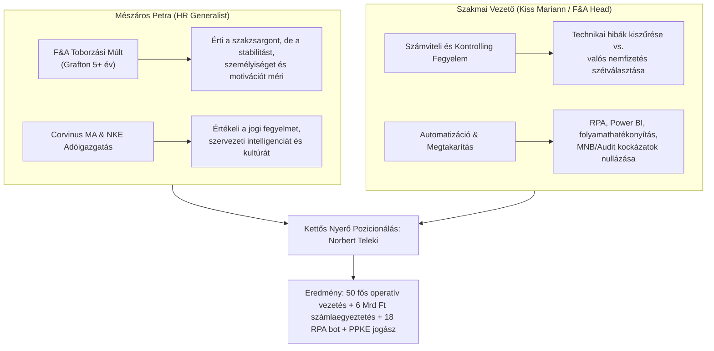

# UNIQA Interjú Szereplők és Döntéshozók Szakmai Dossziéja (2026)
## Pozíció: Collection & Retention Lead – INSURANCE (Budapest, Finance & Accounting)

**Dátum:** 2026. november 8.  
**Cél:** Az interjún résztvevő döntéshozók (HR és Szakmai Vezetés) profiljának, szakmai hátterének, motivációinak, kérdezési dinamikájának és döntési kritériumainak részletes feltárása.

---

## 1. HR DÖNTÉSHOZÓ: MÉSZÁROS PETRA

### 1.1. Szakmai Háttér & Karrierút
* **Jelenlegi pozíció:** **HR Generalist** – **UNIQA Biztosító Zrt.** (2026. július – jelenleg)
* **Korábbi szakmai tapasztalat:**
  * **Grafton Recruitment** (2020. október – 2026. július – közel 6 év):
    * *Senior Recruitment Consultant* (2024 – 2026): Kulcsfontosságú pénzügyi és vállalati ügyfelek kiszolgálása, toborzási projektek end-to-end menedzselése.
    * *Recruitment Consultant* (2021 – 2024): **Finance & Accounting (Pénzügy és Számvitel) specializáció!** Pénzügyi, számviteli, kontrolling és kintlévőség-kezelési szakemberek és vezetők közvetítése multinacionális vállalatokhoz.
    * *Talent Sourcer (Finance & Accounting)* (2020 – 2021): Mélyreható adatbázis- és LinkedIn kutatás, előszűrés, angol nyelvi tesztelés.
  * **Mind-Diák Szövetkezet** (2019 – 2020): HR asszisztens.
* **Tanulmányok & Minősítések:**
  * **Budapesti Corvinus Egyetem** (2018 – 2020): Okleveles Közgazdász, **Vezetés és Szervezés MA**, HR Menedzsment és Szervezetfejlesztés szakirány.
  * **Nemzeti Közszolgálati Egyetem (NKE)** (2015 – 2018): Közigazgatási BA, **Adóigazgatási szakirány**.
  * **Minősítések:** *Thomas High Potential Trait Indicator (HPTI) Practitioner* (vezetői potenciál mérés), *Sourcing Masterclass*.
* **Nyelvtudás:** Angol (tárgyalási szint / Full Professional), Német (korlátozott munkanyelv).

### 1.2. Pszichológiai Profil és Értékelési Fókusz
1. **Pénzügyi-Számviteli Szakzsargon Ismerete:**  
   Mivel Petra 5 éven át a Grafton Recruitmentnél kifejezetten **Finance & Accounting** profilú jelölteket toborzott, nem szimpla HR-es általánosságokban gondolkodik. Pontosan érti, mit jelent a követeléskezelés, a folyószámla-egyeztetés, a kintlévőségi KPI-ok (DSO, aging listák, províziók, elhatárolások, PTP).
2. **Közigazgatási és Adóigazgatási Háttér (NKE):**  
   Értékeli a precizitást, a jogszabályi fegyelmet és a szabályozott működést. A jogász végzettség (PPKE abszolutórium) és az ISO auditori szemlélet kifejezetten pozitív rezonanciát kelt nála.
3. **Kompetencia-alapú és HPTI Értékelés:**  
   Különös figyelmet fordít a vezetői habitusra: hogyan motiválsz, hogyan oldasz meg konfliktusokat, hogyan vezetsz át egy csapatot a változásokon (change management), és mennyire vagy reziliens stresszhelyzetben.
4. **Kulturális Illeszkedés (Culture Fit):**  
   Az UNIQA vállalati értékei: *Living Diversity, Continuous Improvement, Customer-Centricity*. Petra azt vizsgálja, hogy a jelölt csapatjátékos-e, hogyan illeszkedik a hibrid működésbe, és mennyire elkötelezett hosszú távon.

### 1.3. Várható Kérdései Petrának
* *"Miért éppen az UNIQA, és miért most?"*
* *"Több mint 10 évet töltöttél az Intrumnál, egy dedikált behajtócégnél. Miért döntöttél a váltás mellett, és miért egy kompozit biztosító pénzügyi területe a következő lépés?"*
* *"Hogyan jellemeznéd a vezetési stílusodat? Hogyan kezeltél konfliktust vagy teljesítményproblémát egy 50 fős operatív szervezetben?"*
* *"Ebben a pozícióban mind az operációval, mind a pénzügyi vezetéssel szorosan együtt kell működni. Hogyan kezeled a keresztfunkcionális érdekellentéteket?"*

---

## 2. SZAKMAI DÖNTÉSHOZÓ: A PÉNZÜGYI ÉS SZÁMVITELI VEZETŐ

Az UNIQA Biztosító Zrt. szervezeti felépítése és az álláshirdetés szövege (*"Join the Finance and Accounting team of an international insurance company, where you play a key role in making our premium payment processes even more efficient and take ownership of collection of insurance premiums and reminder management area."*) alapján a pozíció a **Pénzügyi és Kockázatkezelési Igazgatósághoz (Finance & Accounting)** tartozik.

### 2.1. A Szakmai Terület Első Számú Vezetői
A szakmai interjún az alábbi vezetők egyike, vagy az általuk delegált Pénzügyi/Számviteli Osztályvezető képviseli a szakterületet:

#### A) KISS MARIANN – Számviteli Rendért Felelős Vezető (Head of Accounting)
* **Szervezeti szerepe:** Az UNIQA Biztosító Zrt. legfelsőbb számviteli vezetője (az MNB és a MABISZ hivatalos nyilvántartása szerinti számviteli rendért felelős vezető).
* **Szakmai fókusz és felügyelet:**
  * Teljes körű biztosítási számvitel, biztosítástechnikai tartalékok és kintlévőségek könyvelése.
  * MABISZ Ellenőrző Bizottsági tapasztalat: kiemelten szigorú belső kontroll, compliance és jogszabályi megfelelés.
  * Kapcsolat az IFRS 17 és a hazai számviteli standardok között.
  * A díjkönyvelés (Premium Accounting) és a banki kivonatok automatikus párosítása, a függő- és technikai számlák likvidálása.
* **Mit keres a jelöltben?**
  * Olyan vezetőt, aki rendet tesz a folyószámlákon, megszünteti a könyvelési és technikai csúszásokat, és szigorúan elválasztja a rendszerhibákat a valós nemfizetéstől.
  * Adatpontosságot, számszaki fegyelmet és auditálhatóságot.

#### B) PAVEL KOPYLOV – Igazgatósági Tag, Pénzügyi és Kockázatkezelési Igazgató (CFO)
* **Szervezeti szerepe:** Az UNIQA Igazgatóságának pénzügyért és kockázatkezelésért (Finance, Actuarial, Risk, Controlling) felelős tagja.
* **Szakmai fókusz:**
  * Nemzetközi cégcsoporti háttér (több mint 15 éves nemzetközi biztosítói tapasztalat).
  * Kintlévőség-állomány (Overdue Receivables) tőkelekötési hatása (Solvency II tőkekövetelmény).
  * DSO (Days Sales Outstanding) radikális csökkentése, cash-flow stabilitás.
  * Automatizáció és riporting: Power BI, valós idejű vezetői dashboardok, hibamentes portfólió-tisztítás.

---

### 2.2. A Szakmai Vezető Elvárásai és Értékelési Horizontja
A szakmai vezető **nem egy elméleti jogászt vagy egy agresszív behajtót keres**, hanem egy **folyamat- és pénzügyi folyamatmenedzsert (Process & Operations Lead)**:

1. **A Folyamathibák Gyors Felszámolása:**  
   Az álláshirdetés kiemeli: *"Identify the causes of outstanding receivables (technical errors, such as data entry issues; and genuine cases of customer non-payment)"*.  
   *A szakmai vezető legnagyobb rémálma:* A rendszer adminisztrációs vagy banki technikai hiba miatt díjnemfizetőnek jelöl egy ügyfelet, kiküldenek egy agresszív felszólítást, felmondják a szerződést, az ügyfél panasszal él az MNB-nél, vagy kár esetén kiderül, hogy jogtalanul törölték a kötvényt.
2. **Reminder Management & Korai Megtérülés (Soft Phase):**  
   Hogyan optimalizálható a fizetési emlékeztetők időzítése (cadence) SMS-ben, e-mailben, ügyfélportálon, hogy minimalizáljuk a postai költségeket és a manuális munkát.
3. **Egyenleg-egyeztetés és Könyveléstechnikai Precizitás:**  
   Hogyan kezeli a részletfizetéseket, túlfizetéseket, téves közleményeket és a banki jóváírási késedelmeket.
4. **Vezetői Riporting & Automatizáció:**  
   Képes-e önállóan Power BI / ERP riportokat specifikálni és bevezetni, amelyek valós időben mutatják a kintlévőségek öregedését (aging bucketek: 0-30, 31-60, 61-90, 90+ nap).

---

## 3. AZ INTERJÚSTRATÉGIA ÖSSZEFOGLALÁSA

### Kulcsüzenetek a Két Szereplőnek:
* **Petrának (HR):** Kiegyensúlyozott, stratégiai gondolkodású vezető vagy, aki stabil hátteret, innovációra nyitott nemzetközi közeget keres, és képes 50+ fős csapatokat empátiával, de kőkemény KPI-fegyelemmel motiválni. (Külön plusz pont: a márciusi pozitív benyomás megerősítése).
* **A Szakmai Vezetőnek (F&A):** Olyan műveleti szakértő vagy, aki az Intrum 700 000 eljárásos monstrum rendszerében és egy 6 milliárd forintos mérlegegyeztetési projektben már bizonyította, hogy a pénzügyi folyamatok legkisebb anomáliáit is képes feltárni és RPA-val/Lean-nel automatizálni. Nem félsz a számviteli logikától, és a jogszabályi hátteret (MNB, Ptk., Vht.) készségszinten alkalmazod a biztosító védelmében.
