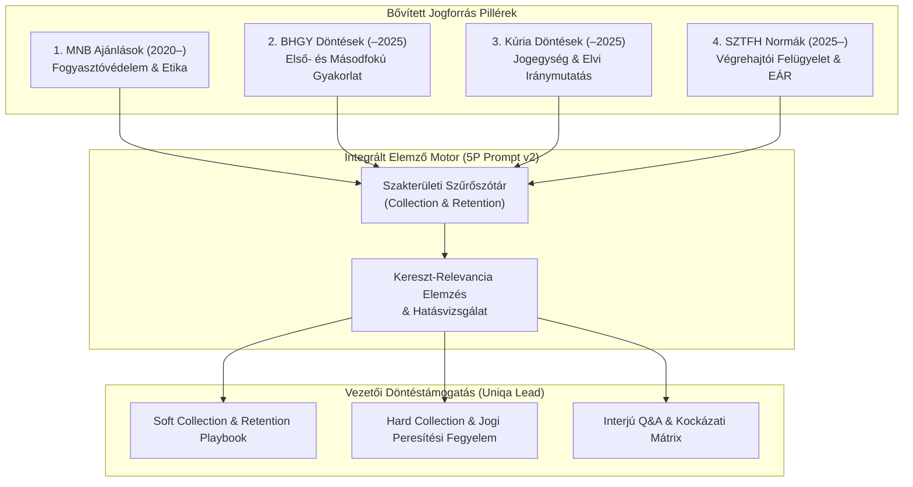

# Rendszer- és Adatforrás-Specifikáció v2.0
## Integrált Döntéstámogató és Jogforrás-Monitorozó Rendszer (Uniqa Collection & Retention Lead)

**Verzió:** 2.0.0  
**Dátum:** 2026. november 6.  
**Célpozíció:** Uniqa – Collection & Retention Lead  
**Fókusz:** 4 bővített jogforrás-pillér integrálása a követeléskezelési és ügyfélmegtartási stratégiába.

---

## 1. Vezetői Célkitűzés és Rendszer-hatókör

A rendszer célja, hogy a **Magyar Közlöny** és az **Indokolások Tára** korábbi (2026. évi) monitorozását kiterjessze egy komplex, 4 új pillérre épülő jogforrás-aggregátorrá és vezetői döntéstámogató eszközzé. 

A biztosítási követeléskezelés (*Collection*) és ügyfélmegtartás (*Retention*) elválaszthatatlan a felügyeleti és bírósági normakörnyezettől:
1. **MNB ajánlások (2020-tól):** Meghatározzák a tisztességes eljárás, az etikus követeléskezelés és a fogyasztóbarát panaszkezelés kereteit. A felügyeleti bírságok és fogyasztóvédelmi kockázatok elkerülésének első védelmi vonala.
2. **BHGY anonimizált határozatok (-2025):** Tényleges bírósági precedensek a végrehajtás megszüntetése/korlátozása, a fedezetlenségi díjak behajtása és a bankszámla-inkasszók bírói megítélése terén.
3. **Kúria határozatok (-2025):** Iránymutató jogegységi döntések (JPE), elvi bírósági határozatok (EBH/EBD) a kötelmi jogi elévülésről, a biztosítási feltételek tisztességtelenségéről és a biztosítói regresszjogosultságról.
4. **SZTFH rendeletek és határozatok (2025-től):** A bírósági végrehajtói kar (MBVK) felettes felügyeleti hatóságának eljárási, díjszabási és elektronikus árverési (EÁR) normái, melyek közvetlenül befolyásolják a hard collection megtérülési idejét és költséghányadát.

---

## 2. A 4 Bővített Adatforrás Részletes Elemzése



---

### Pillér 1: MNB Releváns Ajánlások (2020-tól napjainkig)
* **Elsődleges forrás URL:** `https://www.mnb.hu/felugyelet/szabalyozas/felugyeleti-szabalyozo-eszkozok/ajanlasok`
* **Időbeli hatály:** 2020. január 1-től folyamatosan.
* **Kiemelt szakterületi fókusz:**
  1. *Követeléskezelési magatartási kódex és adósvédelem:* A késedelmes ügyfelekkel történő méltányos kapcsolatfelvétel, hívásgyakoriság és pszichés nyomásgyakorlástól mentes tájékoztatás.
  2. *Panaszkezelési eljárásrend:* A szóbeli és írásbeli panaszok kivizsgálásának minőségi követelményei (a korábbi 7/2021. és a hatályos szabályozás metszete).
  3. *Digitalizáció és kibervédelem:* Ügyfélhitelesítés, elektronikus kár- és követelésértesítők, online fizetési csatornák megfelelősége.
  4. *Termékfelügyeleti és irányítási követelmények (POG):* Élet- és nem-életbiztosítások díjstruktúrája, díjtörlések tisztességes kezelése.
  5. *Kiszervezett tevékenységek ellenőrzése:* Követeléskezelő cégek (collection agency) és ügyvédi irodák feletti biztosítói kontroll kötelezettsége.

### Pillér 2: Bírósági Határozatok Gyűjteménye (BHGY) – Anonimizált Esetek (2025-ig visszamenőleg)
* **Elsődleges forrás URL:** `https://eakta.birosag.hu/anonimizalt-hatarozatok`
* **Időbeli hatály:** 2015 – 2025. december 31.
* **Kiemelt szakterületi fókusz:**
  1. *Vht. 41. § és 56. § szerinti jogorvoslatok:* Végrehajtás megszüntetése vagy korlátozása iránt indított perek a díjtartozás vagy regresszkövetelés vitatása miatt.
  2. *Bankszámla-inkasszó és munkabér-letiltás bírói kontrollja:* A Vht. 79/A. § és 92. § alkalmazása a gyakorlatban; mentesített juttatások téves levonásának bírói orvoslása.
  3. *Gfbt. regressz és fedezetlenségi díj jogérvényesítése:* A kötvénymegszűnés jogszerűségének vizsgálata, kézbesítési fikció megdöntése miatti perlés.
  4. *Elévülés a végrehajtási szakaszban:* Végrehajtási cselekmények elévülést megszakító hatásának vitatása a hitelezői passzivitás esetén.

### Pillér 3: Kúriai Döntések és Jogegységi Határozatok (2025-ig visszamenőleg)
* **Elsődleges forrás URL:** `https://kuria-birosag.hu/hu/kuriai-dontesek`
* **Időbeli hatály:** 2015 – 2025. december 31.
* **Kiemelt szakterületi fókusz:**
  1. *Jogegységi döntések (JPE) a kötelmi jogban:* Szerződéses kikötések tisztességtelensége (fogyasztói szerződésekben az egyoldalú díjemelés, szankciós kamatok semmissége).
  2. *Biztosítási esemény és díjfizetés kapcsolata (Ptk. 6:443. – 6:490. §):* A díjfizetés elmulasztásának következményei, türelmi idő (respiro), felszólító levél formai kellékei a joghatályos felmondáshoz.
  3. *Végrehajtási záradékolás anyagi jogi feltételei:* Közokiratba foglalt kötelezettségvállalások (pl. hitelfedezeti vagy lízinghez kapcsolódó biztosítások) végrehajthatósága.
  4. *Kollektív igényérvényesítés és kártérítési regressz:* Károkozó és biztosító közötti megtérítési igények elévülési és kamatszámítási joggyakorlata.

### Pillér 4: SZTFH Releváns Rendeletei és Határozatai (2025-től napjainkig)
* **Elsődleges forrás URL:** `https://net.jogtar.hu/gyorskereso?keyword=sztfh%20rendelet`
* **Időbeli hatály:** 2025. január 1-től folyamatosan.
* **Kiemelt szakterületi fókusz:**
  1. *Önálló bírósági végrehajtók hatósági felügyelete:* Fegyelmi és panaszkezelési gyakorlat a hitelezői jogok sérelme vagy túlzó végrehajtói költségfelszámítás esetén.
  2. *Elektronikus Árverési Rendszer (EÁR) működése:* Ingatlan és nagyértékű ingóárverések szabályai, licitálási szabályok korszerűsítése.
  3. *Végrehajtási ügyviteli és elektronikus kézbesítési normák:* A biztosítók és végrehajtók közötti digitális adatcsere jogi és informatikai követelményei.
  4. *Díjjegyzékek és költségátalányok ellenőrzése:* A végrehajtási költségek optimalizálása a hitelező (Uniqa) szempontjából.

---

## 3. Szakterületi Szűrőszótár és Taxonómia

A releváns joganyagok és bírósági döntések kinyeréséhez alkalmazandó kulcsszókészlet:

| Szakterületi kategória | Keresőkifejezések és kulcsszavak | Érintett jogszabályok / alapnormák |
| :--- | :--- | :--- |
| **Díjfizetés & Szerződésbontás** | `díjnemfizetés`, `díjtörlés`, `fedezetlenségi díj`, `türelmi idő`, `felszólítás`, `felmondás`, `érvénytelenség` | Ptk. 6:448. §, Gfbt. 13-14. §, Bit. 121. § |
| **Soft Collection & Retention** | `részletfizetés`, `méltányosság`, `panaszkezelés`, `ügyfél-tájékoztatás`, `törlesztési terv`, `megtartás`, `fogyasztóvédelem` | MNB ajánlások, 16/2026. MNB rendelet |
| **Hard Collection & Végrehajtás** | `bírósági végrehajtás`, `fizetési meghagyás`, `FMH`, `záradékolás`, `hatósági átutalási megbízás`, `inkasszó`, `letiltás` | Vht. 21. §, 23/C. §, 79/A. §, 82. § |
| **Mentesítés & Adósvédelem** | `mentes vagyontárgy`, `iskolakezdési támogatás`, `moratórium`, `végrehajtás felfüggesztése`, `korlátozás`, `92. §` | Vht. 92. §, 2026. évi XVI. tv., 2026. évi XXXIII. tv. |
| **KGFB & Casco Regressz** | `regressz`, `megtérítési igény`, `ittas vezetés`, `engedély nélküli vezetés`, `egyetemleges felelősség`, `baleseti kár` | Gfbt. 34. §, Ptk. 6:525. § |
| **Végrehajtói Felügyelet & Árverés**| `SZTFH`, `MBVK`, `végrehajtási kifogás`, `elektronikus árverés`, `EÁR`, `díjjegyzék`, `végrehajtói díj` | Vht. 217. §, SZTFH rendeletek |

---

## 4. Egységes Adatmodell (JSON Schema v2)

Minden begyűjtött és elemzett forrásnak (MNB, BHGY, Kúria, SZTFH) a következő normalizált JSON struktúrában kell megjelennie az adatrétegben:

```json
{
  "$schema": "http://json-schema.org/draft-07/schema#",
  "title": "UniqaLegalDecisionEntry",
  "type": "object",
  "properties": {
    "id": { "type": "string", "example": "KURIA-2024-JPE-0012" },
    "pillar": { 
      "type": "string", 
      "enum": ["MNB_RECOMMENDATION", "BHGY_CASE", "KURIA_DECISION", "SZTFH_DECREE_RULING"] 
    },
    "reference_number": { "type": "string", "example": "Pfv.III.20.145/2024/6." },
    "official_url": { "type": "string", "format": "uri" },
    "publication_date": { "type": "string", "format": "date" },
    "effective_date": { "type": "string", "format": "date" },
    "title": { "type": "string" },
    "core_norm_references": {
      "type": "array",
      "items": { "type": "string" },
      "example": ["Ptk. 6:448. §", "Vht. 79/A. §", "Gfbt. 14. §"]
    },
    "case_summary_hu": { "type": "string" },
    "collection_impact": {
      "relevance_level": { "type": "string", "enum": ["HIGH", "MEDIUM", "LOW", "NONE"] },
      "operational_action": { "type": "string" },
      "risk_note": { "type": "string" }
    },
    "retention_impact": {
      "relevance_level": { "type": "string", "enum": ["HIGH", "MEDIUM", "LOW", "NONE"] },
      "customer_journey_touchpoint": { "type": "string" },
      "retention_strategy": { "type": "string" }
    },
    "interview_talking_points": {
      "type": "array",
      "items": { "type": "string" }
    }
  },
  "required": ["id", "pillar", "reference_number", "publication_date", "title", "collection_impact", "retention_impact"]
}
```

---

## 5. Adatbiztonság és Zero Data Leak v2 Szabályzat

1. **Személyes Adatok Tiltása:** A BHGY és a bírósági ügyiratok automatikus anonimizálásán felül a lokális adatbázisban és a kimenetekben kizárólag perbeli szerepek (`Felperes (Biztosító)`, `I. r. Alperes (Adós/Szerződő)`) szerepelhetnek.
2. **Kereskedelmi és Biztosítási Titok:** A vizsgálat kizárólag nyilvános határozatokra, közzétett MNB ajánlásokra és közlönyadatokra támaszkodik. Ügyféladatok, egyedi kötvényszámok bevitele szigorúan tilos.
3. **Commit Filter:** A `.gitignore` érvényesíti, hogy az átmeneti HTML/XML nyers letöltések és személyes CV-k soha ne kerüljenek szinkronizálásra a távoli GitHub repóba.
