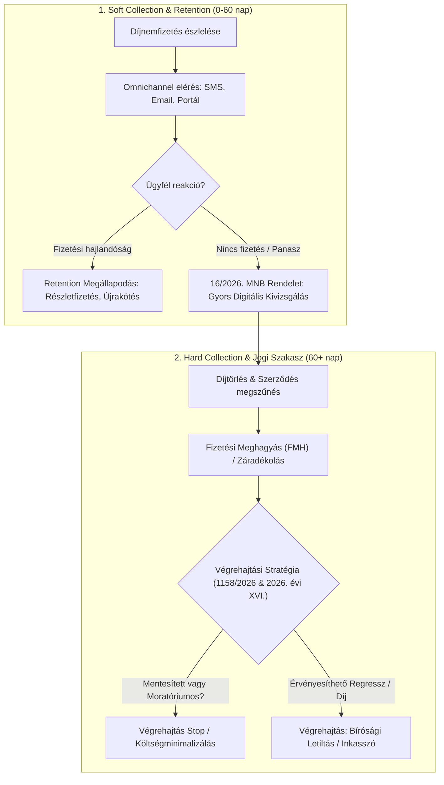

# BÍRÓSÁGI VÉGREHAJTÁSI ÉS BIZTOSÍTÁSI SZEKTORÁLIS JOGSZABÁLYVÁLTOZÁSOK (2026.04.12 – 2026.11.05)
## Felkészítő Vezetői Elemzés és Döntéstámogató Anyag – Uniqa Collection & Retention Lead

---

## VEZETŐI ÖSSZEFOGLALÓ (EXECUTIVE SUMMARY)

A vizsgált időszakban (**2026. április 12. – 2026. november 5.**) a magyar jogalkotás mind a bírósági végrehajtási rendszerben, mind a pénzügyi és biztosítási szektor követeléskezelési és panaszkezelési környezetében fajsúlyos, stratégiai horderejű módosításokat vezetett be:

1. **Paradigmatikus fordulat a végrehajtási rendszer jövőjében:**
   A Kormány **1158/2026. (V. 18.) Korm. határozata** elrendelte a bírósági végrehajtási rendszer (1994. évi LIII. törvény - Vht.) teljes körű felülvizsgálatát azzal a deklarált céllal, hogy a végrehajtás a **bíróságok szervezetrendszerén belülre kerüljön vissza, profitorientációtól mentesen**. Ez a biztosítói hard collection stratégiát alapjaiban érinti: fel kell készülni a független bírósági végrehajtói (MBVK) modell államosítására és átalakulására.
2. **Kényszer-moratórium a fogyasztói hitel- és zálogszerződéseknél:**
   A **2026. évi XVI. törvény** azonnali végrehajtási tilalmat és perfüggesztést rendelt el a devizahiteles törvények alá tartozó fogyasztói szerződésekre, ami közvetlenül kihat a hitelfedezeti élet- és vagyonbiztosítások díjfizetésére és a társbiztosítotti regressz-igények érvényesítésére.
3. **Új szociális mentesítési kategória (Vht. 92. §):**
   A **2026. évi XXXIII. törvény** beiktatta a Vht. 92. § új *e)* pontját, amely **teljes egészében mentesíti a végrehajtás alól** az állami iskolakezdési támogatást (100 000 Ft/gyermek). Ez a bankszámla-letiltások (hatósági átutalási megbízások) végrehajtásánál szigorúbb elkülönítési és felülvizsgálati fegyelmet követel meg.
4. **Új kötelező fogyasztóvédelmi panaszkezelési keretrendszer:**
   A **16/2026. (VI. 3.) MNB rendelet** 2026. július 18-tól hatályon kívül helyezte a korábbi 66/2021. MNB rendeletet. A biztosítók számára szigorodott a szóbeli panaszok digitális megválaszolása, a honlapi közzététel és a hitelgondozói / behajtási viták kezelésének dokumentálása.
5. **Új szuperhatósági adatszolgáltatási kötelezettség:**
   A **2026. évi XXXIV. törvény** létrehozta a Nemzeti Vagyonvisszaszerzési és Vagyonvédelmi Hivatalt (NVVH), módosítva a Vht.-t, a Bit.-et (biztosítási titok alóli mentesség) és a Gfbt.-t (kár- és kötvénynyilvántartási adatszolgáltatás).

---

## I. TÉTÉLES JOGSZABÁLYVÁLTOZÁSI LAJSTROM (2026.04.12 – 2026.11.05)

| Közlöny száma & Dátum | Jogszabály száma & Címe | Módosított alaptörvény / szakasz | Hatálybalépés dátuma | Fő szabályozási tárgy | Biztosítási & Végrehajtási relevanciája *(ha van: részletesen; ha nincs: ÜRES)* |
|---|---|---|---|---|---|
| **MK 2026/44.** 2026.05.09. | **2026. évi XIV. törvény** | Vht. 92. § új d) pont; Vht. új 92/A. § | 2026.05.14. | Vészhelyzeti rendeletek törvényi szintre emelése; Otthontámogatás és sporttámogatás mentesítése | **Végrehajtási & Biztosítási relevancia:** A Vht. 92/A. § alapján az Otthontámogatás teljes összege mentes a bírósági végrehajtás alól, az erre irányuló inkasszó hatálytalan. Lakáshitelekhez kapcsolt hitelfedezeti biztosításoknál és inkasszós díjbehajtásnál kiemelten védett jövedelem. |
| **MK 2026/53.** 2026.05.18. | **1158/2026. (V. 18.) Korm. határozat** | 1994. évi LIII. tv. (Vht.) átfogó felülvizsgálata | 2026.05.18. (felülvizsgálati határidő: 2026.07.14.) | A bírósági végrehajtás nonprofit, bírósági szervezeten belüli megvalósításának előkészítése | **Kiemelten releváns mindkettőre:** Elindítja a magánvégrehajtói hálózat államosítását. A biztosítóknak át kell hangolniuk a hard collection peresítési és záradékolási SLA-it, mivel a bírósági integráció átmeneti leterheltséget és eljárás-lassulást okozhat. |
| **MK 2026/63.** 2026.06.03. | **16/2026. (VI. 3.) MNB rendelet** | Korábbi 66/2021. (XII. 20.) MNB rendelet felváltása; Bit. 439. § a) | 2026.07.18. | Pénzügyi szervezetek (köztük biztosítók) panaszkezelésének formája és módja | **Kifejezetten biztosítási és retention relevanciájú:** Szigorú elvárások a díjhátralékos, behajtás alatt álló ügyfelek panaszainak kivizsgálására, a 30 napos válaszadási határidőre és az elektronikus kapcsolattartásra (pl. ügyfélportál, applikáció). A retention csapat legfontosabb eszköze a jogi szakasz előtt. |
| **MK 2026/66.** 2026.06.09. | **2026. évi XVI. törvény** | Devizahiteles törvények, Vht. eljárási szabályok speciális átmeneti felfüggesztése | 2026.06.10. | Tisztességtelen fogyasztói szerződésekkel kapcsolatos folyamatban lévő perek és végrehajtások kezelése | **Kiemelten releváns mindkettőre:** Végrehajtási stop és kötelező bírósági felfüggesztés. A banki hitelfedezeti biztosításoknál és a társfinanszírozott lízing-/hitelügyletekhez kapcsolódó biztosítói díjköveteléseknél a végrehajtási cselekmények leállnak, a megtérülés késik, az ügyfélmegtartási tárgyalások felértékelődnek. |
| **MK 2026/97.** 2026.07.23. | **2026. évi XXXIII. törvény** | 1994. évi LIII. tv. (Vht.) 92. § új *e)* pont | 2026.07.24. | Állami iskolakezdési támogatás (100 000 Ft/gyermek) bevezetése és végrehajtás alóli mentesítése | **Közvetlen végrehajtási relevancia:** A Vht. 92. § mentes vagyontárgyak köre bővült. Hatósági átutalási megbízásnál és folyószámla-letiltásnál a pénzintézetek nem zárolhatják ezen összegeket. Biztosítói díjbeszedésnél sem terhelhető inkasszóval. |
| **MK 2026/100.** 2026.07.28. | **2026. évi XXXIV. törvény** | Vht. 13., 16., 35., 47/A., 56., 253/E. §; Bit. 135–142. § (biztosítási titok); Gfbt. 47. § (1) p), 51. § (9) m) | 2026.08.01. / fokozatos | Nemzeti Vagyonvisszaszerzési és Vagyonvédelmi Hivatal (NVVH) felállítása és eljárási jogosultságai | **Közvetlen biztosítási és végrehajtási relevancia:** Az új szuperhatóság jogosult a biztosítóktól és a kárnyilvántartóktól (Gfbt.) korlátozás nélkül adatot kérni a vagyonvisszaszerzési eljárásokban. A biztosítási titok alóli mentesség bővült. Végrehajtói szinten az NVVH követelései elsőbbségi vagy kiemelt besorolást kapnak. |
| **MK 2026/112.** 2026.08.13. | **2026. évi XL. törvény** | 1994. évi LIII. tv. (Vht.) 253/E. § (5), 253/G. § (3) | 2026.09.01. | Rendészeti feladatellátás racionalizálása; adatszolgáltatási és körözési hatáskörök pontosítása | **Végrehajtási technikai relevancia:** A gépjármű-foglalások, körözések és felderítési eljárások során a rendőri szervek megnevezése és hatásköre módosult. A lízingelt vagy casco/KGFB fedezet melletti gépjármű-végrehajtásoknál az eljáró rendőri szerv pontosítása. |
| **MK 2026/131.** 2026.09.11. | **2026. évi XLIX. törvény** | Vht. 16. §, 23/B. §, 33. §; Gfbt. 1. § d); egyéb jogszabályok | 2026.10.01. | Terminológiai korrekció: „vármegye” visszaállítása „megye”-re, „főispán” „kormánymegbízott”-ra | *ÜRES* (Pusztán közigazgatási jogtechnikai és terminológiai átvezetés, a behajtási és biztosítási joggyakorlat érdemét nem érinti). |
| **MK 2026/148.** 2026.10.08. | **10/2026. (X. 8.) SZTFH rendelet** | 13/2021. SZTFH rendelet (elektronikus árverés) és kapcsolódó felügyeleti rendeletek | 2026.10.15. | SZTFH hatásköri és terminológiai rendelet-harmonizáció | **Közvetett végrehajtási relevancia:** Az elektronikus árverési rendszer és felügyeleti igazgatási díjak jogszabályi hivatkozásainak korrekciója az árverési végrehajtásokban. |

---

## II. TARTALMI VÁLTOZÁSOK RÉSZLETES ÖSSZEFOGLALÁSA

### 1. Vht. 92. § [Mentes vagyontárgyak és ellátások] kiegészülése
* **Régi norma:** A végrehajtás alól teljes egészében mentes pénzösszegek és ellátások között a családtámogatások (anyasági támogatás, családi pótlék) szerepeltek, de az újonnan bevezetett szociális célú iskoláztatási juttatások nem képeztek nevesített kategóriát.
* **Új norma (2026. évi XXXIII. törvény):** A Vht. 92. § új *e)* pontja kimondja, hogy az iskolakezdési támogatásról szóló kormányrendelet szerinti iskolakezdési támogatás (**100 000 Ft gyermekenként**) teljes összegében mentes a bírósági végrehajtás alól.
* **Konzisztencia a gyakorlatban:** A folyószámla-végrehajtást (Vht. 79/A. § szerinti hatósági átutalási megbízást) teljesítő hitelintézetek ezen összegeket még az általános mentes összeghatáron felül sem zárolhatják vagy utalhatják ki a végrehajtónak.

### 2. A devizahiteles és fogyasztói szerződések végrehajtási moratóriuma (2026. évi XVI. törvény)
* **Régi norma:** A Kúria és az EUB döntései után a bíróságok egyedi kérelemre vagy mérlegelés alapján dönthettek a végrehajtás felfüggesztéséről (Vht. 48. §).
* **Új norma:** 
  1. A bíróságok **hivatalból, soron kívül kötelesek felfüggeszteni** a devizahiteles törvények hatálya alá tartozó fogyasztói pereket (kivéve, ha az adós kifejezetten kéri a per folytatását).
  2. A folyamatban lévő bírósági végrehajtási eljárásokban **főszabály szerint semmilyen végrehajtási cselekmény nem foganatosítható** (végrehajtási stop).
  3. Árverések esetén a vételár-teljesítési kötelezettség a felfüggesztés feloldásáig elhalasztásra kerül; nem jogerős árverésnél a vevő visszakaphatja a vételárat (az előleg kivételével).

### 3. Panaszkezelési és ügyféltájékoztatási szigorítások a biztosítási szektorban (16/2026. MNB rendelet)
* **Régi norma (66/2021. MNB rendelet):** A panaszkezelési nyomtatványok és szabályzatok közzététele csak akkor volt kötelező a honlapon, ha a szolgáltató a honlapot kifejezett jogszabályi kötelezettség alapján üzemeltette. A szóbeli és írásbeli panaszok elektronikus megválaszolása merevebb volt.
* **Új norma:**
  1. **Univerzális webes közzététel:** Bármely biztosító vagy közvetítő, amely weboldalt működtet, köteles közvetlenül elérhetővé tenni a panaszkezelési szabályzatot és az MNB formanyomtatványát.
  2. **Digitális csatornák integrálása:** Az ügyfél kérésére a szóbeli panaszra adott írásbeli érdemi választ kötelező elektronikus úton (ügyfélportál, biztonságos e-mail) megküldeni a korábbi postai lassúság helyett.
  3. **Hitelgondozói és követeléskezelési viták:** A panaszkezelés kiterjed a hitelfelmondásokra és a kiszervezett kintlévőség-kezelési vitákra is.

### 4. A biztosítási titok és adatátadás kiterjesztése az NVVH felé (2026. évi XXXIV. törvény)
* **Bit. módosítás:** A Bit. 135–142. §-a (biztosítási titok megtartása) kiegészült azzal, hogy a biztosító nem tagadhatja meg a tájékoztatást a Nemzeti Vagyonvisszaszerzési és Vagyonvédelmi Hivatal megkeresésére.
* **Gfbt. módosítás:** A gépjármű-felelősségbiztosítási kötvénynyilvántartásból (47. § (1) p)) és a kárnyilvántartásból (51. § (9) m)) az NVVH közvetlen adathozzáférést kapott.

---

## III. A RELEVÁNS INDOKOLÁSOK ÉS NARRATÍV KIVONATUK (INDOKOLÁSOK TÁRA)

### 1. Az iskolakezdési támogatás mentesítésének indoklása (2026. évi XXXIII. törvény – IT 2026/50. szám)
* **Jogalkotói szándék:** Az inflációs nyomás és a megemelkedett megélhetési költségek mellett az iskolakezdés a hátrányos helyzetű, egyszülős vagy tartósan beteg gyermeket nevelő családoknál krízishelyzetet teremt. A 100 000 forintos célzott támogatás kizárólag a gyermek tanulmányi eszközeinek biztosítását szolgálja.
* **TL;DR Jogpolitikai cél:** *A támogatás nem válhat a hitelezők kielégítési alapjává; semmilyen adósság vagy tartozás fejében nem vonható el a gyermektől.*

### 2. A fogyasztói végrehajtások felfüggesztésének indoklása (2026. évi XVI. törvény – IT 2026/39. szám)
* **Jogalkotói szándék:** Az Európai Unió Bíróságának (EUB) és a Kúria jogegységi tanácsának a tisztességtelen szerződési feltételek kapcsán hozott határozatai szükségessé tették a korábbi devizahiteles jogszabályok komplex, strukturális felülvizsgálatát. 
* **TL;DR Jogpolitikai cél:** *El kell kerülni az irreverzibilis joghátrányokat (pl. ingatlanok kiürítése, kényszerértékesítés) mindaddig, amíg a végleges, egységes anyagi jogi rendezés meg nem születik.*

### 3. A bírósági végrehajtási rendszer átalakításának indoklása (1158/2026. Korm. határozat)
* **Kormányzati szándék:** A végrehajtói kamara körüli korábbi korrupciós botrányok és a túlzott profitorientáció aláásták az igazságszolgáltatásba vetett közbizalmat. 
* **TL;DR Stratégiai cél:** *A bírósági végrehajtást ki kell vonni a magánvállalkozási jellegből, és az igazságszolgáltatás szigorúan ellenőrzött, nonprofit közhatalmi tevékenységévé kell alakítani.*

---

## IV. UNIQA COLLECTION & RETENTION LEAD INTERJÚ-STRATÉGIA

*(Optimalizálva a [`debt_HUN.pdf`](file:///C:/Users/norbi/Desktop/CV-k%202026.10/debt_HUN.pdf) önéletrajzban szereplő követeléskezelési vezetői háttérre és az Uniqa üzleti modelljére)*

### 1. "Impact on Collection": Portfólió-tisztítás és Végrehajtási Fegyelem
* **A végrehajtási modell átalakulása (1158/2026. Korm. hat.):** 
  Ha a végrehajtói szervezet bírósági hatáskörbe kerül, a végrehajtási eljárások átfutási ideje az átmeneti időszakban megnőhet. 
  * *Vezetői lépés:* Az Uniqa-nál a **peren kívüli (soft collection) szakasz hatékonyságát kell maximalizálni**, megelőzve, hogy az ügyek a túlterhelt végrehajtási szakaszba kerüljenek.
  * *Külső jogi partnerek menedzselése:* Szigorúbb SLA-k felállítása a végrehajtási lapok kibocsátására és a letiltások ellenőrzésére.
* **Mentesített bevételek (Vht. 92. § *e)* pont):**
  A díjkövetelések és KGFB/Casco regresszek inkasszójánál a behajthatósági kalkulációból le kell vonni a célzott támogatásokat; nem érdemes feleslegesen fenntartani inkasszót, ha a számlán csak védett jövedelem mozog.

### 2. "Impact on Retention": A panaszkezelés és ügyfélmegtartás szinergiája
* **A 16/2026. MNB rendelet adta digitális előny:** 
  Az új panaszkezelési rendelet lehetőséget ad a szóbeli panaszok digitális, azonnali kommunikációjára. Ha egy ügyfél a díjhátralék miatti felszólításra panasszal reagál, a Retention csapatnak ezt **nem vitaként, hanem megtartási lehetőségként** kell kezelnie.
* **Proaktív fizetési könnyítés a díjtörlés előtt:**
  A Gfbt. szerinti díjnemfizetés miatti törlés helyrehozhatatlan (fedezetlenségi díj keletkezik, ami rontja az ügyfél lojalitását). Az új szabályozási környezetben az Uniqa-nak még a törlés előtt (30-45 napos ablakban) fel kell kínálnia a rugalmas részletfizetést vagy a termék-átszerkesztést.

---

### 3. KULCSFONTOSSÁGÚ INTERJÚKÉRDÉSEK ÉS NYERŐ VÁLASZSTRATÉGIA

#### 1. Kérdés: *"Hogyan reagálna Ön vezetőként arra, ha az állam bírósági szervezetté alakítja a végrehajtást (1158/2026. Korm. hat.), ami lassíthatja a követelésbehajtást?"*
> **Modell válaszstratégia:**
> *"A jogszabályi trend világos: a hitelezőknek a soft collection szakaszban kell megnyerniük a megtérülést. Ha a bírósági végrehajtás nonprofit állami modellre vált, a bírósági ügyhátralék átmenetileg nőni fog. Collection & Retention Leadként az Uniqa-nál a következő 3 pillérre építenék:*
> *1. **D+15 és D+45 napos prémium soft collection:** Korszerű scoring modellel szegmentáljuk a késedelmes állományt; az együttműködő ügyfeleknek azonnali digitális részletfizetési vagy fedezet-módosítási alternatívát adunk.*
> *2. **FMH és Jogi eljárások automatizálása:** Csak a szűrt, valós vagyonnal rendelkező regressz- és nagyértékű díjügyeket tereljük végrehajtásba, hogy elkerüljük az Uniqa költségoldali beragadását.*
> *3. **Ügyvédi hálózat SLA-szerződéseinek újratárgyalása:** Sikerdíjas és átfutási időhöz kötött KPI-ok bevezetése a végrehajtási záradékolásban."*

#### 2. Kérdés: *"Milyen hatással van a 16/2026. MNB rendelet az Uniqa Retention folyamataira?"*
> **Modell válaszstratégia:**
> *"Az MNB júliusban hatályba lépett új rendelete megköveteli a panaszkezelés teljes digitalizációját és gyorsítását. A díjnemfizetés miatti megkeresések gyakran torkollnak panaszba (pl. nem érkezett meg a csekk, vitatott kárrendezési levonás). Ha ezt silókban kezeljük, az ügyfél elveszik.*
> *A megoldás: a Collection és a Panaszkezelés szoros integrációja. Ha egy ügyfél panaszt tesz, a végrehajtási/felszólítási órát ideiglenesen megállítjuk, digitális csatornán (applikáció, portál) 5 napon belül tisztázzuk a problémát, és egyidejűleg egy újrakötési vagy megtartási ajánlattal élünk. Ez védi az MNB megfelelőséget és közvetlenül javítja a lapse rate mutatót."*

#### 3. Kérdés: *"Hogyan kezeli a regressz követelések és a hitelfedezeti biztosítások elakadását a 2026. évi XVI. törvény moratóriuma alatt?"*
> **Modell válaszstratégia:**
> *"A 2026. évi XVI. törvény a deviza- és fogyasztói szerződések végrehajtásának leállításával kockázatot jelent a kapcsolódó hitelfedezeti élet- és vagyonbiztosítások díjfolytonosságára. Vezetőként azonnali portfólió-auditot rendelek el: el kell különíteni azokat a szerződéseket, ahol a banki alapügylet felfüggesztés alatt áll.*
> *Ezeknél nem indítunk agresszív jogi lépést, hanem a 'Retention First' elvet alkalmazzuk: tájékoztatjuk az ügyfelet a biztosítási védelem fenntartásának előnyeiről önálló díjfizetés mellett, megelőzve az automatikus díjnemfizetéses felmondást."*

---

> [!TIP]
> **Interjú-Tipp:** Hangsúlyozd bátran a bankszektorban és a követeléskezelésben szerzett tapasztalataidat (CV: `debt_HUN.pdf`), rámutatva arra, hogy a biztosítási szektorban a *Retention* (ügyfélmegtartás) nem különálló marketingtevékenység, hanem a hatékony *Collection* (korai behajtás) közvetlen üzleti ikertestvére.
